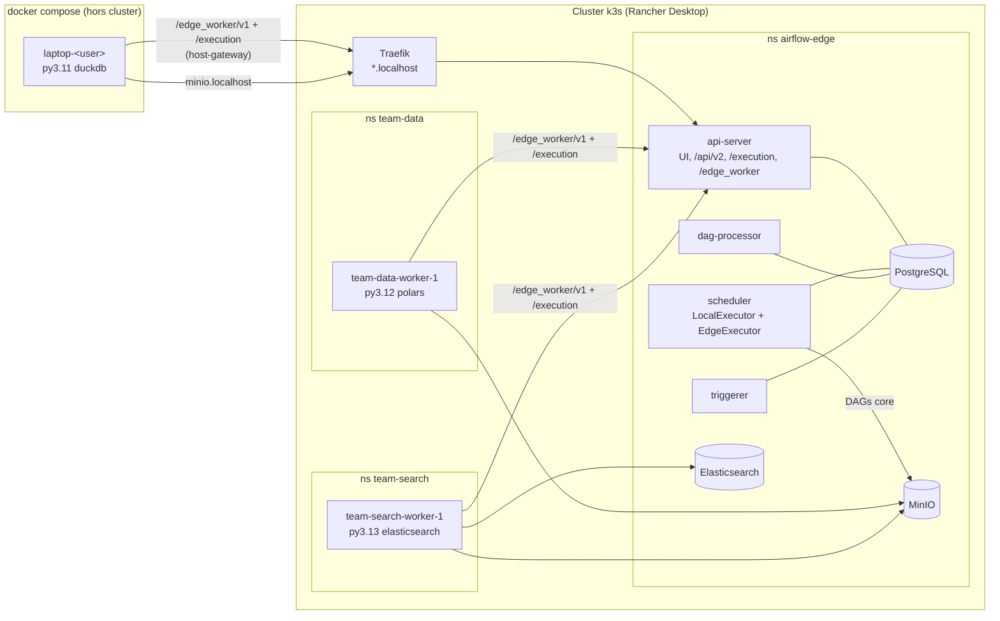

# Airflow 3 + Edge Executor sur Kubernetes local — une plateforme, des équipes, leurs workers

Une démo complète et rejouable, sur un cluster k3s local (Rancher Desktop, Windows) :

- une instance **Airflow 3.3.2** centrale déployée par le **chart Helm officiel 1.22.0** ;
- des **edge workers** (`apache-airflow-providers-edge3` 4.3.2) appartenant à **trois équipes**, avec
  **leurs** libs, **leur** version de Python (3.11, 3.12, 3.13) et **leur** lieu d'exécution
  (deux namespaces Kubernetes et un conteneur Docker **hors du cluster**) ;
- **deux idéologies de DAG côte à côte** : le style Airflow 2 (opérateurs, XCom explicite,
  `TriggerDagRunOperator`, libs dans l'image centrale) exécuté au centre, et le style Airflow 3
  (Task SDK, `@dag/@task`, Assets, dynamic mapping, versioning, Human-in-the-loop) exécuté sur les workers ;
- MinIO (S3) et Elasticsearch comme systèmes externes, des scénarios scriptés avec assertions.

Ce que la démo prouve : le centre parse et planifie des DAGs dont il **n'a pas les libs** ; chaque
tâche s'exécute sur le worker de son équipe, qui n'a **ni base de données ni accès au cluster**, et
une équipe change ses DAGs ou ses dépendances **sans toucher à la plateforme**.

## Architecture



Les workers **tirent** le travail en HTTP (enregistrement JWT, heartbeat, poll des jobs, push des logs) ;
les tâches lisent connexions et variables par l'Execution API. Détails : [docs/01-architecture.md](docs/01-architecture.md).

## Prérequis

| Outil | Notes |
|---|---|
| [Rancher Desktop](https://rancherdesktop.io/) | Kubernetes activé, moteur **dockerd (moby)** : les images construites localement sont vues par k3s |
| [uv](https://docs.astral.sh/uv/) | lance les scripts (`uv run scripts/x.py`), fournit Python |
| helm 4, kubectl | dépôt `apache-airflow` (`up.py` l'ajoute et le met à jour lui-même) |
| RAM | ≈ 3 Gi pour la démo (ES ~800 Mi, scheduler ~570 Mi, workers ~200-250 Mi chacun) |

## Démarrage rapide (clone neuf)

Depuis la racine du repo, PowerShell ou Git Bash :

```bash
helm repo add apache-airflow https://airflow.apache.org   # optionnel : up.py le fait aussi
helm repo update

uv run scripts/build.py                 # image centrale + 3 images worker
uv run scripts/up.py                    # MinIO, ES, Airflow (Helm), connexions, ConfigMaps de DAGs

kubectl apply -k teams/team-data/k8s    # worker team-data
kubectl apply -k teams/team-search/k8s  # worker team-search
uv run scripts/dags.py apply team-data      # DAGs : ConfigMap au centre ET dans le ns de l'équipe
uv run scripts/dags.py apply team-search

cd teams/laptop
docker compose up -d                    # worker hors cluster
cd ../..

uv run scripts/smoke_test.py            # plateforme saine ?
uv run scripts/scenario.py all          # 5 scénarios, 55 contrôles
```

Raccourci tout-en-un (images worker manquantes, workers k8s et laptop compris) :
`uv run scripts/up.py --teams`. La voie détaillée ci-dessus montre ce que fait chaque acteur
(plateforme puis équipes).

Chaque script affiche les commandes `docker` / `kubectl` / `helm` qu'il lance ; les équivalents manuels
sont dans [docs/02-deploiement.md](docs/02-deploiement.md). Démontage : `uv run scripts/down.py --teams`
(release, namespaces `airflow-edge`, `team-data`, `team-search` et `docker compose down` du laptop).

| URL | Quoi | Identifiants |
|---|---|---|
| http://airflow-edge.localhost | UI Airflow ; **Admin → Edge Executor** pour les workers | admin / admin |
| http://minio-console.localhost | console MinIO (bucket `datalake`) | minio / minio12345 |
| http://minio.localhost | API S3 | minio / minio12345 |
| http://es.localhost | Elasticsearch (index `orders`) | — |

> `*.localhost` est résolu par les navigateurs et `curl`, pas par PowerShell ni Python sous Windows :
> utiliser `http://127.0.0.1` avec l'en-tête `Host: airflow-edge.localhost` (les scripts le font).

## Les deux idéologies en 30 secondes

| | Ancienne (style Airflow 2) | Nouvelle (Airflow 3) |
|---|---|---|
| DAG | `with DAG(...)` + `PythonOperator` | `@dag` / `@task` (Task SDK `airflow.sdk`) |
| Données | `ti.xcom_pull(task_ids=...)` | valeurs de retour ; `extra` des événements d'assets |
| Entre DAGs | `TriggerDagRunOperator` (le producteur appelle) | `schedule=[Asset]`, `Asset.ref(name=...)` (le consommateur s'abonne) |
| Tâches dynamiques | boucle figée au parsing | `expand()` à l'exécution |
| Libs | image centrale (`S3Hook`, pandas) | image du worker de l'équipe (polars, elasticsearch, duckdb) |
| Exécution | LocalExecutor, pod scheduler | EdgeExecutor, worker de l'équipe |

Code réel côte à côte : [docs/04-ancien-vs-nouveau.md](docs/04-ancien-vs-nouveau.md).

## Les cas d'usage

| DAG | Équipe / bundle | Worker | Ce qu'il montre |
|---|---|---|---|
| `classic_etl_pipeline` → `classic_report` | core | `airflow-scheduler-0` (LocalExecutor) | ancienne idéologie : opérateurs, XCom explicite, `TriggerDagRunOperator`, `S3Hook` du centre |
| `data_ingest_orders` | team-data | `team-data-worker-1` (py3.12, polars) | `@task`, `expand()` sur 3 régions, parquet → MinIO, `yield Metadata` sur `orders_raw`, `logical_date=None` |
| `data_orders_daily` | team-data | `team-data-worker-1` | `schedule=[orders_raw]`, `inlet_events`, `outlet_events` → `orders_daily` |
| `demo_shorthand` | team-data | `airflow-scheduler-0` | `@asset` n'accepte pas d'executor : tourne **au centre** |
| `search_index_orders` | team-search | `team-search-worker-1` (py3.13, elasticsearch) | `Asset.ref(name="orders_daily")` entre équipes, index ES `orders` |
| `search_reindex_with_approval` | team-search | `team-search-worker-1` | Human-in-the-loop (`ApprovalOperator`, état `awaiting_input`, aucun slot occupé) |
| `search_health_check` | team-search | `team-search-worker-1` | environnement du worker (Python, client ES) |
| `laptop_duckdb_analytics` | laptop | `laptop-<user>` (py3.11, duckdb) | worker hors cluster, déclenché par `orders_daily`, endpoint S3 propre au lieu |
| `laptop_where_am_i` | laptop | `laptop-<user>` | preuve du lieu d'exécution ; `BashOperator` sur un edge worker |
| `data_ingest_orders` v2 | team-data | `team-data-worker-1` | versioning : `dags.py apply team-data --version v2` → nouvelle version en ~65 s, sans rebuild |

Scénarios : `uv run scripts/scenario.py classic|assets|versioning|hitl|isolation|all`
(dernier passage complet : 55/55 contrôles ; classic 9 s, assets 40 s, versioning 142 s, hitl 12 s, isolation 107 s).

## Documentation

| # | Document | Contenu |
|---|---|---|
| 01 | [Architecture](docs/01-architecture.md) | composants, namespaces, cycle de vie d'un worker (séquence), bundles et distribution du code |
| 02 | [Déploiement](docs/02-deploiement.md) | pas à pas, script ↔ commandes manuelles, vérifications, mises à jour, démontage, dimensionnement, Windows |
| 03 | [Edge Executor](docs/03-edge-executor.md) | config serveur et worker, JWT, règle des versions, routage, CLI, UI, routes REST, logs, états, arrêt, pièges |
| 04 | [Ancien vs nouveau](docs/04-ancien-vs-nouveau.md) | extraits de code réels, synthèse des deux idéologies |
| 05 | [Assets, versioning, HITL](docs/05-assets-versioning-hitl.md) | événements et `extra`, `Asset.ref`, versions de DAG, approbation humaine, repères 3.1-3.3 |
| 06 | [Isolation des équipes](docs/06-isolation-equipes.md) | modèle d'équipe, règle D3 et son test, emballage, cibles, partagé vs isolé, production |
| 07 | [Exploitation](docs/07-exploitation.md) | aide-mémoire kubectl / helm / CLI / API, dépannage, nettoyage |
| 08 | [Décisions](docs/08-decisions.md) | ADR D1-D8 et changements de contrat |
| 09 | [Exercice guidé](docs/09-exercice-qualite-air.md) | second cas d'usage à construire soi-même (« qualité de l'air ») : 15 étapes couvrant Airflow 3.0-3.3 et l'Edge Executor, indices, liens doc, pistes de solution |
| 10 | [Reproduire de zéro](docs/10-reproduire.md) | runbook : socle central **avec k8s (Helm), sans k8s (docker compose) ou en venv**, la configuration couche par couche, construire / configurer / déployer un edge worker selon le réseau, où sont les DAGs et comment les livrer (ConfigMap, bind mount, GitDagBundle), vérifier, démonter |

Documents de travail : [PLAN.md](PLAN.md) (contrat entre composants), [platform/README.md](platform/README.md),
[teams/team-data](teams/team-data/README.md), [teams/team-search](teams/team-search/README.md), [teams/laptop](teams/laptop/README.md).

## Organisation du repo

```
PLAN.md                      décisions, contrat (noms, versions, secrets)
platform/                    instance centrale (ns airflow-edge)
  namespace.yaml             namespace + LimitRange
  minio/  elasticsearch/     systèmes externes
  central-image/             apache/airflow:3.3.2 + edge3 4.3.2 + dags/core (ancienne idéologie)
  helm-values/airflow.yaml   values du chart 1.22.0
  compose/                   la même instance centrale SANS Kubernetes (docker compose, dérivé du compose officiel 3.3.2)
scripts/                     build, up, down, dags, smoke_test, scenario (PEP 723 : uv run)
teams/team-data/             Dockerfile py3.12, dags/, versions/v1|v2, k8s/, tests/
teams/team-search/           Dockerfile py3.13, dags/, k8s/, tests/
teams/laptop/                Dockerfile py3.11 slim + uv, dags/, docker-compose.yml, tests/
docs/                        documentation
```

Tests des DAGs d'une équipe (dans son image) :
`docker run --rm -v "$PWD/teams/team-data:/work" -w /work airflow-edge/worker-team-data:dev python -m pytest -q -p no:cacheprovider tests`.

## Limites

- **Démo locale** : un nœud, pas de TLS, secrets fixes en clair (JWT, fernet, mots de passe) dans le repo.
- **DAGs par ConfigMap** (`LocalDagBundle`) : propagation ~1 min, 1 MiB max, code non épinglé par run — en production, `GitDagBundle`.
- **Isolation d'exécution, pas de sécurité** : un seul secret JWT, connexions et variables lisibles par tous les workers.
- **api-server à 1 replica** : les logs des tâches Edge sont sur son disque local (`emptyDir`).
- Observé en 3.3.2 : un DAG planifié par `Asset.ref` n'a pas de `triggering_asset_events` (lire `inlet_events`) ; `@asset` ne peut pas cibler un edge worker ; Windows natif non supporté pour un worker (Docker ou WSL).
