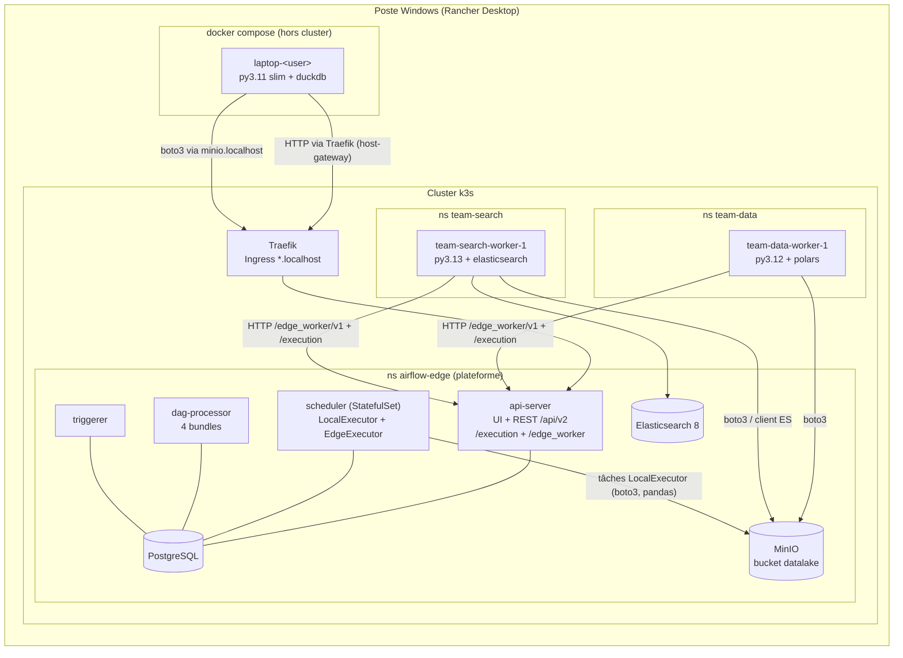
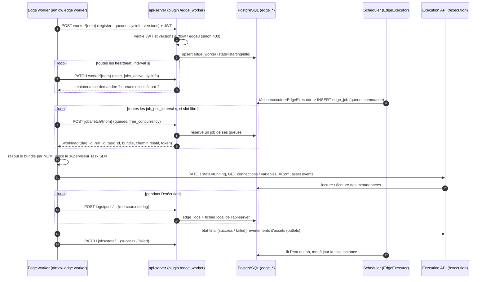
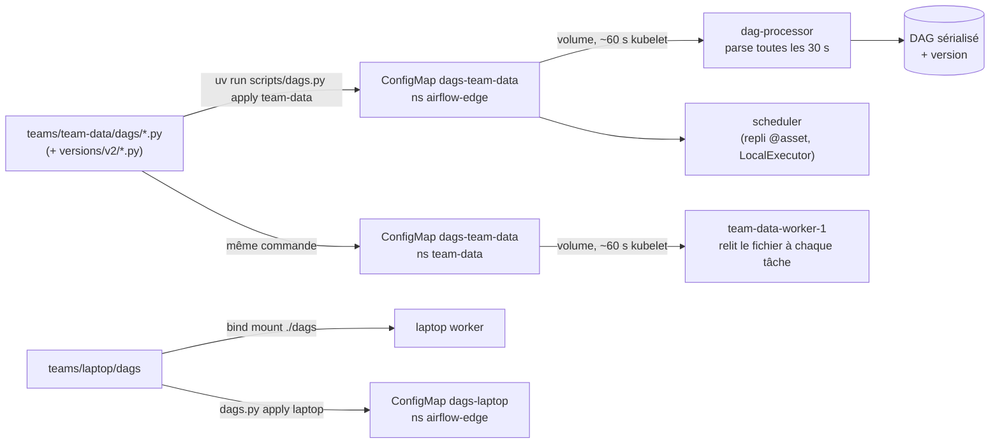
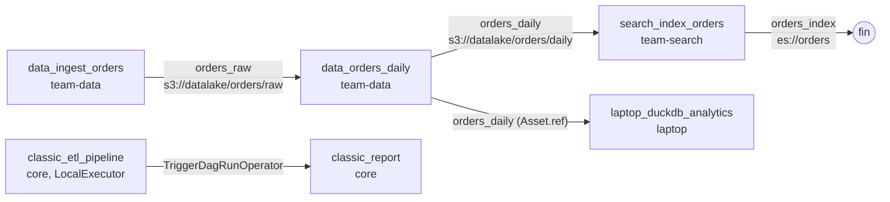

# 01 — Architecture

Une instance Airflow **3.3.2** centrale (chart Helm officiel 1.22.0) dans le namespace `airflow-edge`,
et des **edge workers** (provider `apache-airflow-providers-edge3` 4.3.2) qui appartiennent aux équipes
et tournent ailleurs : deux namespaces d'équipe et un conteneur Docker hors du cluster.

## 1. Vue d'ensemble



Les workers n'ont **ni base de données, ni fernet, ni accès Kubernetes** : tout passe en HTTP par
l'api-server. Les tâches "classiques" (bundle `core`) s'exécutent en sous-processus du scheduler.

## 2. Composants et namespaces

| Namespace | Composant | Type | Créé par | Rôle |
|---|---|---|---|---|
| `airflow-edge` | `airflow-api-server` | Deployment (1 replica) | chart | UI, REST `/api/v2`, Execution API `/execution`, plugin Edge `/edge_worker/*`, réception des logs Edge |
| `airflow-edge` | `airflow-scheduler` | **StatefulSet** (LocalExecutor ⇒ PVC de logs 1Gi) | chart | planification ; héberge `LocalExecutor` (8 process pré-forkés) et `EdgeExecutor` |
| `airflow-edge` | `airflow-dag-processor` | Deployment | chart | parse les 4 bundles (`core`, `team-data`, `team-search`, `laptop`) |
| `airflow-edge` | `airflow-triggerer` | Deployment | chart | tâches différées (aucune dans la démo, présent par défaut) |
| `airflow-edge` | `airflow-postgresql` | StatefulSet | chart | métadonnées + tables `edge_worker`, `edge_job`, `edge_logs` |
| `airflow-edge` | `minio` + Job `minio-init` | Deployment + Job | [`platform/minio/minio.yaml`](../platform/minio/minio.yaml) | S3 (bucket `datalake`) |
| `airflow-edge` | `elasticsearch` | Deployment (8.19.6, heap 256m) | [`platform/elasticsearch/elasticsearch.yaml`](../platform/elasticsearch/elasticsearch.yaml) | index `orders` |
| `airflow-edge` | ConfigMaps `dags-<team>` | ConfigMap | `scripts/dags.py apply` | DAGs d'équipe parsés au centre |
| `team-data` | `team-data-worker` | Deployment (1 replica, `Recreate`) | [`teams/team-data/k8s`](../teams/team-data/k8s) | worker edge, queue `team-data` |
| `team-search` | `team-search-worker` | Deployment (1 replica, `Recreate`) | [`teams/team-search/k8s`](../teams/team-search/k8s) | worker edge, queue `team-search` |
| (hors cluster) | `laptop-worker` | service docker compose | [`teams/laptop/docker-compose.yml`](../teams/laptop/docker-compose.yml) | worker edge, queue `laptop` |

### Ce que crée le chart, ce que créent les équipes

| Chart Helm (`platform/helm-values/airflow.yaml`) | Équipe (son dossier `teams/<team>/`) |
|---|---|
| api-server, scheduler, dag-processor, triggerer, PostgreSQL, Jobs de migration et de création d'utilisateur, Ingress `airflow-edge.localhost` | image du worker (Dockerfile : Python, libs) |
| config `[core] executor`, `[edge] api_enabled`, `jwtSecret` fixe | Namespace, Secret `airflow-edge-worker` (JWT), Deployment du worker — ou un `docker-compose.yml` |
| déclaration des 4 bundles + montage des ConfigMaps (optionnelles) | ses DAGs (`dags/*.py`) publiés en ConfigMap par `dags.py apply` |
| **aucun worker edge** (pas de clé de values dédiée) | queue (= nom d'équipe) et hostname stable |

## 3. Cycle de vie d'un edge worker

Toutes les requêtes du worker vers `/edge_worker/v1/*` portent un JWT **signé localement** avec
`[api_auth] jwt_secret` (claim `method` = chemin appelé, validité courte). Le serveur vérifie la
signature avec le même secret : un secret différent donne **403**.



Points clés :

- L'URL de l'Execution API est **déduite** de `AIRFLOW__EDGE__API_URL` : le worker remplace
  `edge_worker/v1/rpcapi` par `execution` (sauf si `[core] execution_api_server_url` est défini).
- `/edge_worker/v1/rpcapi` n'est qu'une **URL de base** : la route elle-même répond 404. Sonde :
  `/edge_worker/v1/health` (200).
- Le worker ne parle jamais à la base : connexions et variables (`Connection.get("minio_s3")`,
  `Variable.get("datalake_bucket")`) passent par l'Execution API avec le jeton du workload.
- Détails, états, maintenance : [03-edge-executor.md](03-edge-executor.md).

## 4. Bundles de DAGs et distribution du code

Un **DAG bundle** (Airflow 3) est une source de fichiers DAG nommée. Le dag-processor parse chaque bundle ;
le worker reçoit le **nom** du bundle et le **chemin relatif** du fichier, et cherche le fichier dans *son*
bundle de même nom (les chemins absolus peuvent différer).

| Bundle | Source | Chemin au centre | Chemin sur le worker |
|---|---|---|---|
| `core` | cuit dans l'image centrale | `/opt/airflow/dags/core` | — (LocalExecutor, au centre) |
| `team-data` | ConfigMap `dags-team-data` | `/opt/airflow/dags/team-data/..data` | idem (ConfigMap du ns `team-data`) |
| `team-search` | ConfigMap `dags-team-search` | `/opt/airflow/dags/team-search/..data` | idem (ConfigMap du ns `team-search`) |
| `laptop` | ConfigMap `dags-laptop` (centre) / `./dags` (compose) | `/opt/airflow/dags/laptop/..data` | `/opt/airflow/dags/laptop` (bind mount) |



Pourquoi `..data` : un volume ConfigMap contient `..<horodatage>/` (vrai répertoire) et le lien
`..data -> ..<horodatage>`. Le parcours de bundle d'Airflow suit les liens et plante
(`Detected recursive loop when walking DAG directory`) sur la racine du montage, même si la ConfigMap
est absente. Pointer sur `<montage>/..data` ne montre que les vrais fichiers, toujours la dernière version.

Le scheduler monte aussi les ConfigMaps : une tâche d'équipe qui tombe sur l'executor par défaut
(cas de `@asset`, voir [03](03-edge-executor.md#5-routage--executor-et-queue)) s'exécute au centre et doit trouver son fichier.

En production : `GitDagBundle` (un dépôt par équipe, code épinglé par run) plutôt que des ConfigMaps — voir
[05](05-assets-versioning-hitl.md#2-versioning-de-dags) et [06](06-isolation-equipes.md#8-recommandations-production).

## 5. Données et flux métier



| Asset | URI | Producteur | Consommateurs |
|---|---|---|---|
| `orders_raw` | `s3://datalake/orders/raw` | `data_ingest_orders.publish` | `data_orders_daily` |
| `orders_daily` | `s3://datalake/orders/daily` | `data_orders_daily.aggregate_daily` | `search_index_orders`, `laptop_duckdb_analytics` (par `Asset.ref`) |
| `orders_index` | `es://orders` | `search_index_orders.publish` | — |
| `demo_shorthand` | `s3://datalake/demo/asset_shorthand` | `demo_shorthand` (`@asset`) | — |

## 6. Organisation du repo

```
PLAN.md                     décisions, contrat (noms, versions, secrets)
platform/                   instance centrale : namespace, MinIO, ES, image, values Helm
  central-image/            Dockerfile (officielle + edge3) + dags/core (DAGs "anciens")
  helm-values/airflow.yaml  values du chart 1.22.0
scripts/                    build, up, down, dags, smoke_test, scenario (PEP 723, uv run)
teams/<team>/               Dockerfile, requirements.txt, dags/, tests/, k8s/ ou docker-compose.yml
docs/                       cette documentation
```
