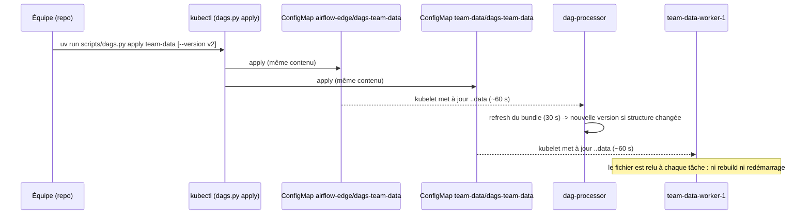

# 06 — Isolation des équipes

Le problème que l'Edge Executor résout : avec un Airflow central classique, **toutes** les libs de
**toutes** les équipes doivent être installées dans l'image centrale, avec une seule version de Python,
et chaque ajout impose un redéploiement de la plateforme. Ici, chaque équipe porte son environnement
dans son propre worker ; le centre ne fait que parser, planifier et servir l'API.

## 1. Ce qu'une équipe possède

| Élément | team-data | team-search | laptop |
|---|---|---|---|
| image | `apache/airflow:3.3.2-python3.12` + libs | `apache/airflow:3.3.2` (py3.13) + libs | `python:3.11-slim` + uv |
| Python | 3.12.14 | 3.13.15 | 3.11.17 |
| libs propres | polars, boto3 | elasticsearch 8.19, pandas, pyarrow, boto3 | duckdb, boto3 (ni pandas ni polars) |
| où tourne le worker | Deployment, ns `team-data` | Deployment, ns `team-search` | docker compose, hors cluster |
| bundle de DAGs | `team-data` | `team-search` | `laptop` |
| queue / hostname | `team-data` / `team-data-worker-1` | `team-search` / `team-search-worker-1` | `laptop` / `laptop-<USERNAME>` |
| secret | Secret `airflow-edge-worker` (ns `team-data`) | Secret `airflow-edge-worker` (ns `team-search`) | `.env` (`JWT_SECRET`) |
| tests | [`tests/test_dags.py`](../teams/team-data/tests/test_dags.py) | [`tests/test_dags.py`](../teams/team-search/tests/test_dags.py) | [`tests/test_dags.py`](../teams/laptop/tests/test_dags.py) |

Versions Python relevées dans `sysinfo` des workers (`GET /edge_worker/ui/worker`) et dans les logs
des tâches (scénario `isolation`). Le laptop affiche `'polars': None, 'pandas': None` : ces libs y sont absentes.

## 2. La règle D3

> Un fichier DAG d'équipe doit être **parseable au centre sans les libs de l'équipe** : les imports
> spécifiques se font **dans** les fonctions de tâche.

Le dag-processor central n'a ni polars, ni elasticsearch, ni duckdb. Un `import polars` en tête de fichier
donnerait une erreur d'import au centre, et le DAG n'existerait pas.

```python
# teams/team-data/dags/data_ingest_orders.py
@task
def generate_orders(region: str) -> dict:
    """Génère des commandes synthétiques (polars) et les écrit en parquet sur MinIO."""
    import io
    import random
    import zlib

    import polars as pl  # import local : règle D3
```

Pour les annotations de type, `TYPE_CHECKING` (jamais évalué au parsing) :

```python
# teams/team-search/dags/search_common.py
if TYPE_CHECKING:  # annotations seulement : jamais évaluées au parsing
    from elasticsearch import Elasticsearch
```

Les modules utilitaires sont permis : le dossier du bundle est dans le `sys.path` côté centre comme
côté worker (`from search_common import ...`) ; préfixer leur nom pour éviter les collisions entre bundles.

**Test qui la fait respecter** : chaque fichier est parsé dans un sous-processus où les libs de l'équipe
sont **bloquées** (extrait de [`teams/team-data/tests/test_dags.py`](../teams/team-data/tests/test_dags.py)) :

```python
_BLOCKED_PARSE = """
import sys
for mod in ("polars", "boto3", "botocore"):
    sys.modules[mod] = None  # tout `import polars` lève désormais ImportError
from airflow.dag_processing.dagbag import DagBag
bag = DagBag(dag_folder=sys.argv[1])
assert not bag.import_errors, bag.import_errors
...
```

Les mêmes tests vérifient le routage (`(t.executor, t.queue) == ("EdgeExecutor", "team-data")`, sauf la tâche
`@asset`). Ils tournent **dans l'image du worker** :

```bash
docker run --rm -v "$PWD/teams/team-data:/work" -w /work airflow-edge/worker-team-data:dev python -m pytest -q -p no:cacheprovider tests
```

(Git Bash : `MSYS_NO_PATHCONV=1` et `$(pwd -W)` au lieu de `$PWD`.)

## 3. Trois façons d'emballer un worker

| Style | Exemple | Avantages | Points d'attention |
|---|---|---|---|
| variante officielle de l'image | team-data : `FROM apache/airflow:3.3.2-python3.12` | Python choisi, contraintes officielles | ~1 Go+ ; installer edge3 avec `constraints-3.3.2/constraints-3.12.txt` |
| image officielle + libs | team-search : `FROM apache/airflow:3.3.2` | le plus simple | conflit possible avec les contraintes : ici le client ES 9.x épinglé a été retiré pour `elasticsearch>=8.15,<9` (serveur 8.x) |
| image slim + uv | laptop : `FROM python:3.11-slim`, `uv pip install -r requirements.txt --constraint ...` | ≈ 164 Mo compressée, build à froid ≈ 40 s (mesures du README laptop) | à maintenir soi-même (utilisateur, `AIRFLOW_HOME`) |

Dans tous les cas : `apache-airflow==3.3.2` et `apache-airflow-providers-edge3==4.3.2` **exactement**.

## 4. Où déployer un worker

| Cible | Exemple | Notes |
|---|---|---|
| Kubernetes, autre namespace (ou autre cluster) | [`teams/team-data/k8s/worker.yaml`](../teams/team-data/k8s/worker.yaml) | `hostname:` fixe, 1 replica, `Recreate` |
| Docker / docker compose sur une machine | [`teams/laptop/docker-compose.yml`](../teams/laptop/docker-compose.yml) | `stop_signal: SIGINT` (drain), `extra_hosts` vers l'Ingress |
| venv sur Linux / macOS / WSL | [`teams/laptop/README.md`](../teams/laptop/README.md#alternative-sans-docker-linux--macos--wsl) | non testé dans la démo ; Windows natif non supporté |

Le seul flux réseau nécessaire : **worker → api-server en HTTP(S)** (`/edge_worker/*` et `/execution/*`),
plus l'accès aux systèmes que les tâches utilisent. Le laptop passe par Traefik :

```
conteneur ──(extra_hosts airflow-edge.localhost → host-gateway)──▶ hôte :80 ──▶ Traefik ──▶ svc airflow-api-server:8080
conteneur ──(extra_hosts minio.localhost → host-gateway)──▶ hôte :80 ──▶ Traefik ──▶ svc minio:9000
```

Un endpoint qui dépend du lieu d'exécution se surcharge localement : la connexion `minio_s3` porte
l'URL interne au cluster, le laptop la remplace par `MINIO_ENDPOINT_URL=http://minio.localhost`
(voir [`laptop_duckdb_analytics.py`](../teams/laptop/dags/laptop_duckdb_analytics.py), `_s3_settings()`).

## 5. Source unique des DAGs



La copie `COPY dags/` des images d'équipe ne sert plus qu'aux tests locaux (le montage la masque).
Le laptop monte `./dags` directement, mais doit **aussi** publier au centre (`dags.py apply laptop`).

## 6. Démos d'exploitation (scénario `isolation`)

| Cas | Action | Observé |
|---|---|---|
| environnement par worker | `search_health_check`, `laptop_where_am_i` | `team-search-worker-1` Python 3.13.15, client ES 8.19.3 ; `laptop-chris` Python 3.11.17, duckdb 1.5.6, sans polars ; un `BashOperator` affiche `edge worker: laptop-chris` |
| worker arrêté | `kubectl -n team-search scale deploy/team-search-worker --replicas=0` | worker `offline` ; `cluster_health` reste `queued` 30 s, aucun autre worker ni le centre ne la prend ; repart dès `--replicas=1` |
| maintenance | `POST /edge_worker/ui/worker/team-data-worker-1/maintenance` (ou `airflow edge remote-edge-worker-request-maintenance -H team-data-worker-1 -c demo`) | état `maintenance mode` ; `list_regions` reste `queued` ; s'exécute après `DELETE .../maintenance` |
| versions différentes | worker avec un autre Airflow / edge3 | refusé par le serveur (HTTP 400) — comportement lu dans le code du provider, non rejoué par le scénario |

## 7. Partagé ou isolé ?

| Partagé (centre) | Isolé (équipe) |
|---|---|
| version d'Airflow et d'edge3 | version de Python, OS, image |
| secret JWT (`jwtSecret`) : **un seul** pour tous les workers | libs Python, binaires système |
| connexions et variables (lues via l'Execution API : toute tâche peut lire toute connexion) | lieu d'exécution, réseau, ressources (requests/limits du worker) |
| base de métadonnées, UI, droits utilisateurs | queue, concurrence (`-c`), maintenance |
| assets : espace de noms global | DAGs (bundle par équipe) |

Conséquence : l'isolation est **d'exécution** (dépendances, ressources, lieu), pas **de sécurité**.
Un worker peut demander les connexions des autres équipes, et quiconque a le secret JWT peut se faire
passer pour n'importe quel worker.

## 8. Recommandations production

- **DAGs** : un dépôt par équipe, `GitDagBundle` par équipe (code épinglé par run, `bundle_version` = commit),
  au lieu des ConfigMaps. Même nom de bundle au centre et sur le worker.
- **CI par équipe** : build de l'image worker avec les contraintes officielles, tests D3 et de routage,
  push dans un registry ; montée de version d'Airflow coordonnée avec la plateforme.
- **Secrets** : `jwtSecret`, fernet et `apiSecretKey` dans un gestionnaire de secrets (External Secrets,
  Vault...) ; jamais en clair dans les values. Connexions via un secrets backend, avec des connexions
  préfixées par équipe.
- **Multi-team (3.2, expérimental)** : pour aller vers une isolation des connexions, variables et droits
  par équipe ; à évaluer, l'Execution API n'applique pas encore de frontière d'équipe (aide de `airflow edge worker -t`).
- **Logs** : logging distant au lieu de l'`emptyDir` de l'api-server, pour pouvoir scaler l'api-server.
- **Arrêt** : les workers k8s de la démo sont drainés par un `preStop` (SIGINT au worker, voir
  [03 §10](03-edge-executor.md#10-arrêt-propre)) ; en production, ajouter un PodDisruptionBudget et
  dimensionner `DRAIN_TIMEOUT_SEC` sur la durée des tâches longues.
- **Réseau** : HTTPS entre workers et api-server ; NetworkPolicy n'autorisant que ce flux.
