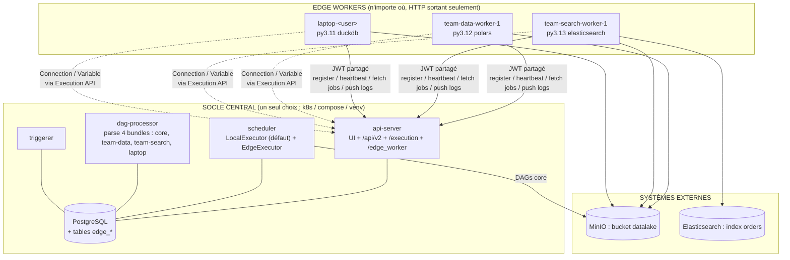
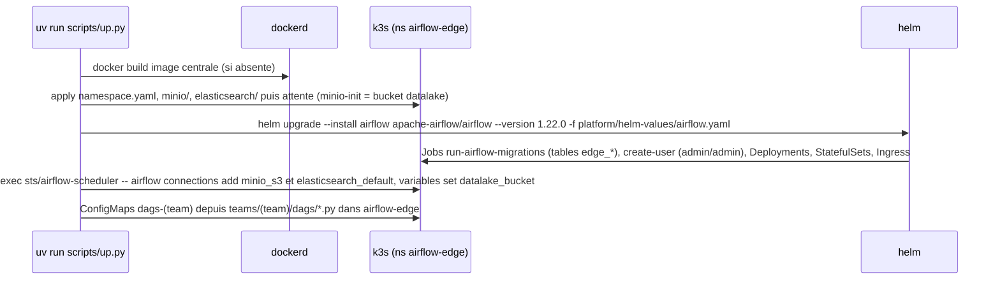
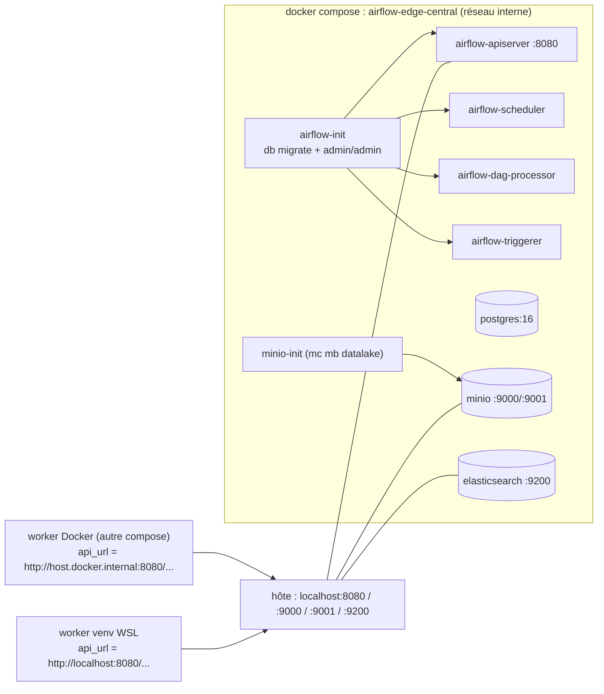
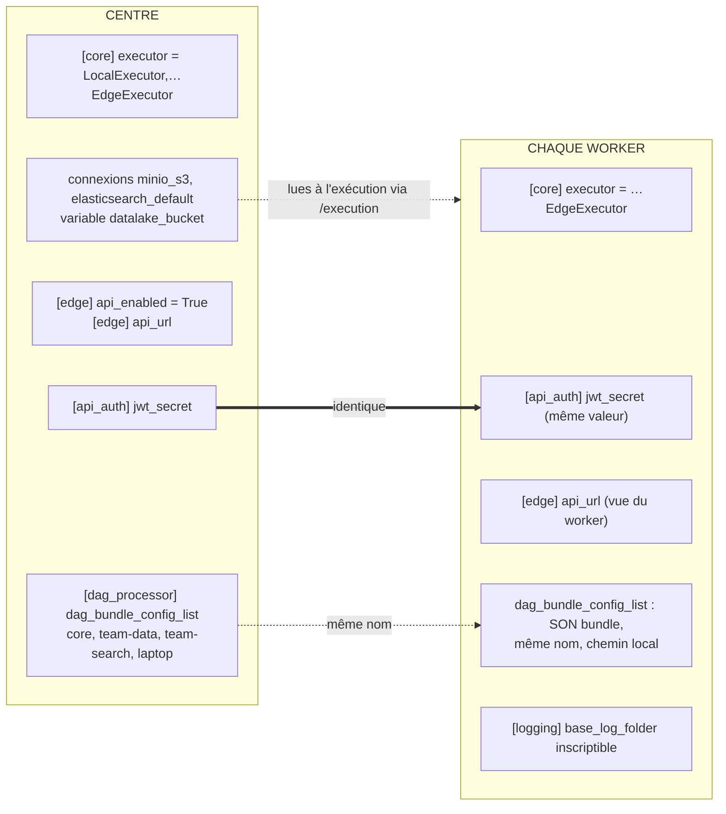
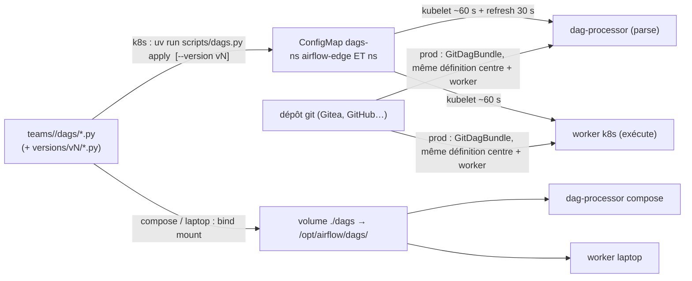

# 10 — Reproduire la plateforme de zéro (socle Airflow, Edge workers, DAGs)

Runbook autonome : repartir d'un poste vide (ou d'un cluster vidé) et rebâtir **la même chose** que la
démo, en choisissant le mode d'hébergement du socle central — **Kubernetes (Helm)**, **docker compose**
ou **venv Linux/WSL** — puis brancher les edge workers et publier les DAGs. Chaque étape renvoie vers le
fichier du repo qui la porte et vers le document détaillé ([01](01-architecture.md) à [08](08-decisions.md)).

Versions figées par le contrat ([PLAN.md](../PLAN.md)) : **Airflow 3.3.2**, provider
**edge3 4.3.2**, chart Helm **1.22.0**, contraintes officielles `constraints-3.3.2`. Vérifié le 2026-10-30
contre les docs officielles (liens en fin de document).

## 0. Ce que l'on reconstruit



Trois invariants, quel que soit le mode :

1. **Mêmes versions** d'Airflow et d'edge3 sur le centre et sur chaque worker (sinon le worker est refusé, HTTP 400).
2. **Même `jwt_secret`** partout (sinon 403) et **mêmes noms de bundles** (le worker résout un DAG par nom de bundle + chemin relatif).
3. Une tâche d'équipe porte `executor="EdgeExecutor"` **et** `queue="<équipe>"` ; son fichier se parse au centre
   **sans** les libs de l'équipe (règle D3 : imports dans les fonctions de tâche).

## 1. Prérequis

| Outil | Mode k8s | Mode compose | Mode venv | Note |
|---|---|---|---|---|
| Docker (dockerd) | oui, moteur de Rancher Desktop | oui | non | les images locales sont vues par k3s avec `imagePullPolicy: IfNotPresent` |
| Rancher Desktop (k3s) + `kubectl` + `helm` | oui | non | non | contexte `rancher-desktop`, Traefik fourni (`*.localhost`) |
| `uv` | oui | oui | oui | lance les scripts PEP 723 (`uv run scripts/x.py`), fournit Python ; pas de `python` global requis |
| Linux / macOS / WSL2 | — | — | **obligatoire** | Airflow ne tourne pas nativement sous Windows (fork, signaux POSIX) ; les workers non plus |
| RAM | ≈ 3 Gi pour la démo | ≈ 3 Gi | ≈ 1,5 Gi (sans ES) | voir [02 §7](02-deploiement.md#7-dimensionnement) |

```bash
git clone https://github.com/Norwende/airflow-edge-examples.git airflow && cd airflow
kubectl config use-context rancher-desktop          # mode k8s seulement
helm repo add apache-airflow https://airflow.apache.org && helm repo update   # idem (up.py le fait aussi)
```

## 2. Le contrat : les constantes à ne pas inventer

Tout le repo partage ces valeurs (source : [PLAN.md](../PLAN.md) § CONTRAT). Changer l'une d'elles =
la changer **partout** (values Helm, compose, Secret des workers, `.env` du laptop).

| Quoi | Valeur | Où elle est utilisée |
|---|---|---|
| Image centrale | `airflow-edge/airflow-central:3.3.2` | [`platform/central-image/Dockerfile`](../platform/central-image/Dockerfile), values Helm, compose |
| Images worker | `airflow-edge/worker-team-data:dev`, `…-team-search:dev`, `…-laptop:dev` | `teams/<team>/Dockerfile`, `k8s/worker.yaml`, `docker-compose.yml` |
| Executors | `LocalExecutor,airflow.providers.edge3.executors.EdgeExecutor` (le 1er = défaut) | centre **et** tests des équipes |
| `jwt_secret` | `airflow-edge-demo-jwt-secret-please-change-0123456789` | values `jwtSecret`, Secret `airflow-edge-worker` (clé `jwt-secret`), `.env` |
| `fernet_key` / `api secret_key` | `YWlyZmxvdy1lZGdlLWRlbW8tZmVybmV0LWtleS0zMmI=` / `airflow-edge-demo-api-secret-key` | centre seulement |
| Bundles | `core`, `team-data`, `team-search`, `laptop` (`LocalDagBundle`) | dag-processor, scheduler, chaque worker (son seul bundle) |
| Queues / hostnames | `team-data` / `team-data-worker-1`, `team-search` / `team-search-worker-1`, `laptop` / `laptop-<user>` | `airflow edge worker -q … -H …`, `hostname:` du pod |
| Connexions | `minio_s3` (type `aws`, `minio`/`minio12345`, extra `endpoint_url`), `elasticsearch_default` (host, 9200, `http`) | créées au centre ; lues par `airflow.sdk.Connection.get()` |
| Variable | `datalake_bucket` = `datalake` | `airflow.sdk.Variable.get()` |
| Assets | `orders_raw` = `s3://datalake/orders/raw`, `orders_daily` = `s3://datalake/orders/daily`, `orders_index` = `es://orders` | DAGs des équipes, `Asset.ref(name=…)` entre équipes |
| URLs (k8s) | `http://airflow-edge.localhost` (admin/admin), `http://minio.localhost`, `http://minio-console.localhost`, `http://es.localhost` | Ingress Traefik ; PowerShell/Python : `http://127.0.0.1` + en-tête `Host:` |
| URLs (compose) | `http://localhost:8080`, `http://localhost:9000` / `:9001`, `http://localhost:9200` | ports publiés |

## 3. Le socle Airflow central

Le socle = api-server + scheduler + dag-processor + triggerer + PostgreSQL, **tous** sur l'image centrale
(l'image officielle n'embarque pas edge3 : l'executor tourne dans le scheduler, le plugin d'API dans
l'api-server). L'image se construit une fois, quel que soit le mode :

```bash
uv run scripts/build.py --central      # = docker build -t airflow-edge/airflow-central:3.3.2 platform/central-image
```

[`platform/central-image/Dockerfile`](../platform/central-image/Dockerfile) : `FROM apache/airflow:3.3.2`,
`pip install apache-airflow==3.3.2 apache-airflow-providers-edge3==4.3.2 --constraint constraints-3.3.2/constraints-3.13.txt`,
puis `COPY dags/core/` (DAGs "ancienne idéologie", bundle `core`).

### 3.A Avec Kubernetes (chart Helm officiel) — la voie de la démo



```bash
uv run scripts/up.py              # enchaîne tout ; relançable ; --build reconstruit l'image, --skip-helm saute le chart
```

Équivalent manuel, étape par étape : [02 §2](02-deploiement.md#2-plateforme-centrale) et
[`platform/README.md`](../platform/README.md). Ce que fait chaque clé des values
[`platform/helm-values/airflow.yaml`](../platform/helm-values/airflow.yaml) :

| Clé | Rôle | Si on l'oublie |
|---|---|---|
| `airflowVersion: "3.3.2"` + `images.airflow` | le chart 1.22.0 a `appVersion 3.2.2` ; on force la version et notre image | templates inadaptés, pas de provider edge3 |
| `executor: "LocalExecutor,airflow.providers.edge3.executors.EdgeExecutor"` | hybride, chemin complet exigé par les templates | tâches Edge jamais prises |
| `jwtSecret`, `fernetKey`, `apiSecretKey` fixés | les workers partagent `jwtSecret` ; un secret généré change à chaque `helm upgrade` | 403 des workers après upgrade |
| `config.edge.api_enabled: "True"` | monte `/edge_worker/*` sur l'api-server | 405 côté worker |
| `config.edge.api_url` | URL de l'API vue par le scheduler (`…svc.cluster.local:8080/edge_worker/v1/rpcapi`) | executor sans API |
| `config.database.external_db_managers` | tables `edge_*` à la migration (auto-enregistré depuis Airflow 3.2 : clé conservée, sans effet) | — |
| `config.core.parallelism: 8` | process LocalExecutor pré-forkés (32 ≈ 1 Go) | scheduler à 1 Go au repos |
| `dagProcessor.dagBundleConfigList` | 4 bundles, chemins `<montage>/..data` pour les ConfigMaps | `Detected recursive loop` si on pointe la racine du montage |
| `dagProcessor`/`scheduler.extraVolumes` + `Mounts` | ConfigMaps `dags-<team>` montées (optionnelles, sans `subPath`) | DAGs d'équipe invisibles ; `@asset` ne trouve pas son fichier |
| `apiServer.replicas: 1` | les logs Edge sont poussés sur son disque local | logs éparpillés |
| `workers.replicas: 0`, `redis.enabled: false`, `statsd.enabled: false` | pas de Celery : les workers sont ceux des équipes | ressources gâchées |
| `ingress.apiServer` (`traefik`, `airflow-edge.localhost`) | UI/API et point d'entrée du worker hors cluster | pas d'accès navigateur |
| `createUserJob`/`migrateDatabaseJob.useHelmHooks: false` | Jobs normaux (TTL 300 s), pas de blocage de `--wait` | — |

### 3.B Sans Kubernetes — docker compose

[`platform/compose/docker-compose.yml`](../platform/compose/docker-compose.yml) est dérivé du
[docker-compose.yaml officiel 3.3.2](https://airflow.apache.org/docs/apache-airflow/3.3.2/docker-compose.yaml) :
mêmes services `airflow-init` / `airflow-apiserver` / `airflow-scheduler` / `airflow-dag-processor` /
`airflow-triggerer` / `postgres`, mais notre image, pas de Celery (ni redis ni `airflow-worker`), MinIO et
Elasticsearch dans le même réseau, et la configuration du contrat en variables d'environnement.



```bash
cd platform/compose
cp .env.example .env                         # optionnel : secrets, admin, AIRFLOW_UID
docker compose build                         # ou uv run scripts/build.py --central (même tag)
docker compose up airflow-init               # migrations (tables edge_* comprises) + utilisateur admin/admin
docker compose up -d
curl -s http://localhost:8080/api/v2/monitor/health
curl -s http://localhost:8080/edge_worker/v1/health          # {"status":"healthy"}
docker compose exec airflow-scheduler airflow edge list-workers
```

Correspondance avec le mode k8s (tout passe par `AIRFLOW__<SECTION>__<CLÉ>`, cf.
[config env vars](https://airflow.apache.org/docs/apache-airflow/3.3.2/howto/set-config.html)) :

| k8s (values) | compose (env) | Remarque |
|---|---|---|
| `executor`, `jwtSecret`, `fernetKey`, `apiSecretKey` | `AIRFLOW__CORE__EXECUTOR`, `AIRFLOW__API_AUTH__JWT_SECRET`, `AIRFLOW__CORE__FERNET_KEY`, `AIRFLOW__API__SECRET_KEY` | mêmes valeurs |
| `config.edge.api_url` (svc k8s) | `AIRFLOW__EDGE__API_URL=http://airflow-apiserver:8080/edge_worker/v1/rpcapi` | nom du service compose |
| réglé par le chart | `AIRFLOW__CORE__EXECUTION_API_SERVER_URL=http://airflow-apiserver:8080/execution/` | comme le compose officiel |
| `dagBundleConfigList` (chemins `..data`) | `AIRFLOW__DAG_PROCESSOR__DAG_BUNDLE_CONFIG_LIST` (chemins **sans** `..data`) | bind mounts `teams/<team>/dags` = répertoires ordinaires |
| `airflow connections add …` dans le scheduler | `AIRFLOW_CONN_MINIO_S3`, `AIRFLOW_CONN_ELASTICSEARCH_DEFAULT`, `AIRFLOW_VAR_DATALAKE_BUCKET` | backend "variables d'environnement" lu par l'Execution API ; endpoints `http://minio:9000`, `elasticsearch:9200` |
| Jobs du chart | service `airflow-init` (`_AIRFLOW_DB_MIGRATE`, `_AIRFLOW_WWW_USER_CREATE`, `_AIRFLOW_WWW_USER_USERNAME/PASSWORD`) | entrypoint de l'image officielle |
| Ingress `*.localhost` | `ports: 8080:8080`, `9000`, `9001`, `9200` | `AIRFLOW__API__BASE_URL=http://localhost:8080` |
| PVC logs / emptyDir | volume nommé `logs` partagé par tous les services | l'api-server sert les logs du scheduler |

> **Statut** : ce compose est dérivé ligne à ligne du fichier officiel 3.3.2 et de la
> [doc de déploiement edge3 4.3.2](https://airflow.apache.org/docs/apache-airflow-providers-edge3/4.3.2/deployment.html),
> mais **n'a pas encore été déroulé** sur ce poste (le daemon Docker était indisponible au moment de l'écriture,
> 2026-10-30). Le mode 3.A est, lui, validé de bout en bout (55/55 contrôles, [README](../README.md)).
> En mode compose, les scripts `up.py` / `dags.py` / `scenario.py` (qui parlent à kubectl et à l'Ingress) ne
> s'appliquent pas : utiliser `docker compose` et `curl` sur `localhost:8080`.

### 3.C Sans conteneur — venv sur Linux / WSL2 (`airflow standalone`)

Pour un poste de développement. Suit le [Quick Start 3.3.2](https://airflow.apache.org/docs/apache-airflow/3.3.2/start.html) ;
`airflow standalone` "initialise la base, crée un utilisateur et démarre tous les composants".

```bash
export AIRFLOW_HOME=$PWD/.airflow
uv venv -p 3.12 .venv && source .venv/bin/activate
uv pip install "apache-airflow==3.3.2" "apache-airflow-providers-edge3==4.3.2" \
  --constraint https://raw.githubusercontent.com/apache/airflow/constraints-3.3.2/constraints-3.12.txt

export AIRFLOW__CORE__EXECUTOR=LocalExecutor,airflow.providers.edge3.executors.EdgeExecutor
export AIRFLOW__CORE__LOAD_EXAMPLES=False
export AIRFLOW__API_AUTH__JWT_SECRET=airflow-edge-demo-jwt-secret-please-change-0123456789
export AIRFLOW__EDGE__API_ENABLED=True
export AIRFLOW__EDGE__API_URL=http://localhost:8080/edge_worker/v1/rpcapi
export AIRFLOW__DAG_PROCESSOR__DAG_BUNDLE_CONFIG_LIST='[{"name":"core","classpath":"airflow.dag_processing.bundles.local.LocalDagBundle","kwargs":{"path":"'$PWD'/platform/central-image/dags/core"}},{"name":"team-data","classpath":"airflow.dag_processing.bundles.local.LocalDagBundle","kwargs":{"path":"'$PWD'/teams/team-data/dags"}}]'
airflow standalone                      # SQLite + SimpleAuthManager ; mot de passe admin :
cat $AIRFLOW_HOME/simple_auth_manager_passwords.json.generated
```

Équivalent "à la main" (une fenêtre par composant) : `airflow db migrate`, `airflow api-server --port 8080`,
`airflow scheduler`, `airflow dag-processor`, `airflow triggerer`. Limites : SQLite = pas de parallélisme réel,
SimpleAuthManager (pas de `airflow users create`), pas de MinIO/ES sauf à les lancer en Docker à côté.
Même API Edge et même CLI qu'ailleurs : un worker venv (§5.3) s'y branche sur `http://localhost:8080`.

## 4. La configuration, vue d'ensemble

Trois couches, toujours les mêmes, exprimées différemment selon le mode (values Helm → env des pods ;
compose → `environment:` ; venv → `export` ou `airflow.cfg`). Référence : [03 §1-2](03-edge-executor.md#1-configuration-côté-serveur-values-helm).



| Côté | Clé (section/clé → variable) | Valeur dans la démo | Pourquoi |
|---|---|---|---|
| centre | `[core] executor` | `LocalExecutor,airflow.providers.edge3.executors.EdgeExecutor` | liste séparée par des virgules, **le premier est le défaut** ; un executor absent de la liste ne peut pas exécuter de tâche |
| centre | `[api_auth] jwt_secret` | contrat | secret partagé worker ↔ api-server (obligatoire depuis 3.0) |
| centre | `[edge] api_enabled` | `True` | `False` par défaut : l'endpoint n'est pas exposé |
| centre | `[edge] api_url` | `http://<api-server>/edge_worker/v1/rpcapi` | URL de base (le chemin `rpcapi` lui-même répond 404 : normal) |
| centre | `[core] parallelism` | `8` | créneaux par executor et process pré-forkés |
| centre | `[dag_processor] refresh_interval` | `30` | fréquence de rafraîchissement des bundles |
| centre | `[dag_processor] dag_bundle_config_list` | 4 `LocalDagBundle` | pas de bundle `dags-folder` par défaut |
| centre | connexions / variable | `minio_s3`, `elasticsearch_default`, `datalake_bucket` | CLI dans le scheduler (k8s) ou `AIRFLOW_CONN_*` / `AIRFLOW_VAR_*` (compose) |
| worker | `[core] executor` | `airflow.providers.edge3.executors.EdgeExecutor` | active la CLI `airflow edge` |
| worker | `[edge] api_url` | dépend du lieu (§5.4) | l'Execution API en est déduite |
| worker | `[api_auth] jwt_secret` | contrat | **même valeur** que le centre |
| worker | `[dag_processor] dag_bundle_config_list` | `[{"name":"<team>", …LocalDagBundle, "path": …}]` | même **nom** qu'au centre ; chemin local |
| worker | `[logging] base_log_folder` | `/opt/airflow/logs` | copie locale des logs avant push |
| worker | `[edge] heartbeat_interval` / `job_poll_interval` | `10` / `2` (défauts 30 / 5) | démo plus réactive |
| worker | `[edge] drain_timeout_sec` | `45` (k8s) / `30` (laptop) ; défaut `0` = infini | borne le drain à l'arrêt |

Toutes les clés `[edge]` et leurs défauts :
[configurations-ref 4.3.2](https://airflow.apache.org/docs/apache-airflow-providers-edge3/4.3.2/configurations-ref.html)
(`worker_concurrency = 8`, `push_logs = True`, `push_log_chunk_size = 524288`, `job_success_purge = 5`,
`job_fail_purge = 60`, `minimum_acceptable_*_version_for_workers`, `automatic_maintenance_on/exit`…).

## 5. Les edge workers : construire, configurer, déployer

### 5.1 Ce qu'il faut, et rien de plus

Un worker n'a **ni base de données, ni fernet, ni accès au cluster**. Il lui faut :

1. Airflow **3.3.2** + edge3 **4.3.2** exactement (la version de Python, elle, est libre : 3.11, 3.12, 3.13 ici) ;
2. les cinq variables du tableau §4 (executor, api_url, jwt_secret, bundle, base_log_folder) ;
3. ses libs métier (polars, elasticsearch, duckdb…) ;
4. ses fichiers DAG au chemin de son bundle ;
5. un **hostname stable** (`-H`) : c'est l'identité du worker en base (sinon fantômes `offline`).

Commande : `airflow edge worker -q <queue> -c <concurrence> -H <hostname>` (`-q` : queues séparées par des
virgules, toutes si absent ; arrêt propre `airflow edge stop` ou SIGINT = drain ; SIGTERM = arrêt dur).

### 5.2 Emballer un worker : trois styles éprouvés

| Style | Fichier | Base | Quand |
|---|---|---|---|
| variante officielle de l'image | [`teams/team-data/Dockerfile`](../teams/team-data/Dockerfile) | `apache/airflow:3.3.2-python3.12` + `pip install … --constraint constraints-3.12.txt` | choisir sa version de Python en restant sur l'image officielle |
| image officielle + libs | [`teams/team-search/Dockerfile`](../teams/team-search/Dockerfile) | `apache/airflow:3.3.2` | le plus simple ; attention aux conflits de contraintes (client ES `>=8.15,<9`) |
| image slim + uv | [`teams/laptop/Dockerfile`](../teams/laptop/Dockerfile) | `python:3.11-slim` + `uv pip install --system -r requirements.txt --constraint constraints-3.11.txt` | image légère (~164 Mo), utilisateur et `AIRFLOW_HOME` à gérer soi-même |

```bash
uv run scripts/build.py --team team-data        # = docker build -t airflow-edge/worker-team-data:dev teams/team-data
docker run --rm airflow-edge/worker-team-data:dev python -c "import airflow, sys; from airflow.providers.edge3 import __version__ as v; print(airflow.__version__, v, sys.version)"
```

Pour une **nouvelle équipe** : copier `teams/team-data/` (Dockerfile, `requirements.txt`, `dags/`, `k8s/`,
`tests/`), remplacer `team-data` par le nom de l'équipe partout (image, namespace, queue, hostname, bundle,
label), ajouter le bundle + le volume + le montage dans
[`platform/helm-values/airflow.yaml`](../platform/helm-values/airflow.yaml) (ou dans le compose), ajouter le
nom dans `TEAMS` de [`scripts/_common.py`](../scripts/_common.py). Exercice guidé complet : [09, niveau 1](09-exercice-qualite-air.md#niveau-1--une-équipe-de-plus).

### 5.3 Déployer un worker

**Kubernetes** (équipes `team-data`, `team-search`) — [`teams/team-data/k8s/`](../teams/team-data/k8s/worker.yaml) :
Namespace + Secret `airflow-edge-worker` (clé `jwt-secret`) + Deployment 1 replica, `strategy: Recreate`,
`hostname: team-data-worker-1`, ConfigMap `dags-team-data` montée sur `/opt/airflow/dags/team-data`
(bundle = `…/..data`), `preStop` qui envoie SIGINT au PID du worker (drain) et `terminationGracePeriodSeconds: 90`.

```bash
kubectl apply -k teams/team-data/k8s
uv run scripts/dags.py apply team-data          # crée la ConfigMap dans le ns de l'équipe : le pod démarre
kubectl -n team-data rollout status deploy/team-data-worker
```

**docker compose** (équipe `laptop`, hors cluster) — [`teams/laptop/docker-compose.yml`](../teams/laptop/docker-compose.yml) :
`hostname: laptop-${USERNAME}`, `stop_signal: SIGINT` + `stop_grace_period: 60s`, `./dags` monté en lecture
seule (bundle `laptop`, répertoire ordinaire), `extra_hosts` `*.localhost → host-gateway`, `.env` pour surcharger.

```bash
cd teams/laptop && cp .env.example .env && docker compose up -d --build && docker compose logs -f
```

**venv Linux / WSL2** — [`teams/laptop/README.md`](../teams/laptop/README.md#alternative-sans-docker-linux--macos--wsl) :
mêmes variables en `export`, `airflow edge worker -q laptop -c 2 -H laptop-$USER`.

### 5.4 Réseau : quelle `api_url` selon où tournent le centre et le worker

Le seul flux nécessaire est **worker → api-server en HTTP(S)** (`/edge_worker/*` puis `/execution/*`),
plus l'accès aux systèmes que les tâches utilisent (ici MinIO, ES).

| Centre ↓ / Worker → | pod k8s (autre namespace) | conteneur Docker sur l'hôte | venv WSL/Linux |
|---|---|---|---|
| **k8s** (3.A) | `http://airflow-api-server.airflow-edge.svc.cluster.local:8080/edge_worker/v1/rpcapi` | `http://airflow-edge.localhost/edge_worker/v1/rpcapi` + `extra_hosts: airflow-edge.localhost:host-gateway` (Traefik :80) ; repli `kubectl port-forward … 8080` + `http://host.docker.internal:8080/…` | `kubectl port-forward -n airflow-edge svc/airflow-api-server 8080:8080` puis `http://localhost:8080/…` |
| **compose** (3.B) | non prévu (le cluster ne voit pas l'hôte sans route) | `http://host.docker.internal:8080/edge_worker/v1/rpcapi` (ou rejoindre le réseau `airflow-edge-central_default` et utiliser `http://airflow-apiserver:8080/…`) | `http://localhost:8080/edge_worker/v1/rpcapi` |
| **venv** (3.C) | — | `http://host.docker.internal:8080/…` | `http://localhost:8080/…` |

Même logique pour MinIO : la connexion `minio_s3` porte l'endpoint **vu du centre** ; un worker ailleurs le
surcharge par `MINIO_ENDPOINT_URL` (lu par les DAGs du laptop) — `http://minio.localhost` en k8s,
`http://host.docker.internal:9000` ou `http://localhost:9000` en compose.

Exemple `.env` du laptop quand le centre est en compose :

```
EDGE_API_URL=http://host.docker.internal:8080/edge_worker/v1/rpcapi
MINIO_ENDPOINT_URL=http://host.docker.internal:9000
```

### 5.5 Vérifier et exploiter un worker

```bash
# centre (k8s)                                                 # centre (compose)
kubectl -n airflow-edge exec sts/airflow-scheduler -c scheduler -- airflow edge list-workers
                                                                docker compose -f platform/compose/docker-compose.yml exec airflow-scheduler airflow edge list-workers
# worker
kubectl -n team-data exec deploy/team-data-worker -- airflow edge status
docker compose -f teams/laptop/docker-compose.yml exec laptop-worker airflow edge maintenance on -c "pause"
```

UI : **Admin → Edge Executor** (`/plugin/edge_executor`) ; API JSON : `GET /edge_worker/ui/worker`.
États, maintenance, arrêt propre, commandes à distance : [03 §6-10](03-edge-executor.md#6-cli).
Dépannage (403, 405, 400, `queued` sans fin, fantômes) : [03 §11](03-edge-executor.md#11-pièges) et [07 §2](07-exploitation.md#2-dépannage).

## 6. Les DAGs : où ils sont, comment les écrire, comment les livrer

### 6.1 Où ils sont

```
platform/central-image/dags/core/   classic_etl_pipeline.py, classic_report.py   bundle core    (cuits dans l'image, LocalExecutor)
teams/team-data/dags/               data_ingest_orders.py, data_orders_daily.py, asset_shorthand_demo.py   bundle team-data
teams/team-data/versions/v1|v2/     variantes de data_ingest_orders.py (démo de versioning)
teams/team-search/dags/             search_common.py (module partagé), search_index_orders.py, search_reindex_with_approval.py, search_health_check.py   bundle team-search
teams/laptop/dags/                  laptop_where_am_i.py, laptop_duckdb_analytics.py   bundle laptop
teams/<team>/tests/test_dags.py     tests d'intégrité (import, routage, règle D3)
```

Le bundle d'un DAG se lit dans l'UI et dans `GET /api/v2/dags` (`bundle_name`) ; les bundles configurés
sont dans la table `dag_bundle` (`uv run scripts/dags.py status`).

### 6.2 Écrire un DAG d'équipe (nouvelle idéologie, exécuté sur le worker)

Modèle : [`teams/team-data/dags/data_ingest_orders.py`](../teams/team-data/dags/data_ingest_orders.py).
Les règles qui comptent :

```python
from airflow.sdk import Asset, Connection, Variable, dag, task      # Task SDK : jamais airflow.models / airflow.operators

@dag(
    dag_id="data_ingest_orders",
    schedule=None,
    default_args={"executor": "EdgeExecutor", "queue": "team-data", "owner": "team-data"},   # routage : les DEUX
    tags=["team-data"],
)
def data_ingest_orders():
    @task
    def generate_orders(region: str) -> dict:
        import polars as pl          # règle D3 : lib d'équipe importée DANS la tâche (le centre ne l'a pas)
        conn = Connection.get("minio_s3")      # via l'Execution API, pas de DB
        ...
```

| Règle | Pourquoi | Vérifiée par |
|---|---|---|
| `executor="EdgeExecutor"` **et** `queue="<team>"` (via `default_args` ou sur chaque tâche) | `queue` seul ne route pas ; sans executor → LocalExecutor au centre | `test_routing_edge` |
| imports des libs d'équipe **dans** les fonctions de tâche | le dag-processor central doit parser le fichier sans ces libs | `test_parse_without_team_libs` (bloque `polars`, `boto3` puis parse) |
| `@asset` ne prend ni `executor` ni `queue` (3.3.2) | une tâche `@asset` tourne au centre : corps en bibliothèque standard seulement | `test_routing_edge` (`ASSET_DAG`) |
| assets d'une autre équipe par `Asset.ref(name=…)` | pas d'import du code de l'autre équipe | — (observé : `triggering_asset_events` vide, lire `inlet_events`) |
| `logical_date` peut être `None` (run manuel) | Airflow 3 | `_run_date()` dans les DAGs |

Tests (dans l'image du worker, donc avec ses libs **et** la même configuration d'executors) :

```bash
docker run --rm -v "$PWD/teams/team-data:/work" -w /work airflow-edge/worker-team-data:dev python -m pytest -q -p no:cacheprovider tests
```

### 6.3 Livrer les DAGs : trois mécanismes



| Mécanisme | Centre | Worker | Propagation | Code épinglé par run | Quand |
|---|---|---|---|---|---|
| **ConfigMap** (`dags.py apply`) | montage `<montage>/..data` | montage identique dans le ns de l'équipe | ~60-80 s, sans rebuild ni redémarrage | non (`bundle_version = None`) | démo k8s ; 1 MiB max par ConfigMap |
| **bind mount** | `teams/<team>/dags` → `/opt/airflow/dags/<team>` | `./dags` monté | immédiat côté fichiers, 30 s côté parsing | non | compose, laptop |
| **GitDagBundle** | `classpath: airflow.providers.git.bundles.git.GitDagBundle`, `kwargs: {git_conn_id, tracking_ref, refresh_interval}` | **même définition** + `AIRFLOW_CONN_<ID>` en env (le worker clone lui-même) | `refresh_interval` | **oui** (`bundle_version` = SHA) | production ; déroulé dans [09 étape 15.a](09-exercice-qualite-air.md#étape-15--bonus--gitdagbundle-et-multi-team) |

Commandes k8s du quotidien :

```bash
uv run scripts/dags.py apply team-data                  # publie dags/ au centre + ns team-data
uv run scripts/dags.py apply team-data --version v2     # superpose versions/v2/*.py (nouvelle version de DAG en ~65 s)
uv run scripts/dags.py status                           # ConfigMaps, table dag_bundle, DAGs par bundle, erreurs d'import
uv run scripts/dags.py delete team-data
```

Important : `dags.py apply` n'écrit la ConfigMap de l'équipe que si son namespace **existe déjà**
(`kubectl apply -k teams/<team>/k8s` d'abord). Le laptop monte `./dags` mais doit **aussi** être publié au
centre (`dags.py apply laptop`) pour être parsé. Une nouvelle **version de DAG** n'apparaît que si la
**structure** change ([05 §2](05-assets-versioning-hitl.md#2-versioning-de-dags)).

Les DAGs **core** (ancienne idéologie) sont cuits dans l'image : modification = `uv run scripts/build.py --central`
puis `kubectl -n airflow-edge rollout restart deploy/airflow-dag-processor sts/airflow-scheduler`
(ou `docker compose up -d --build` en mode compose).

## 7. Vérifier de bout en bout

Mode k8s (scripts du repo) :

```bash
uv run scripts/smoke_test.py            # santé, DAGs, bundles, plugin Edge, tables edge_*, MinIO, ES
uv run scripts/smoke_test.py --run      # + classic_etl_pipeline -> classic_report (LocalExecutor)
uv run scripts/scenario.py all          # classic, assets, versioning, hitl, isolation : 55 contrôles
uv run scripts/dags.py status
```

Tous modes (à la main) :

| Contrôle | k8s | compose |
|---|---|---|
| API saine | `curl -s -H "Host: airflow-edge.localhost" http://127.0.0.1/api/v2/monitor/health` | `curl -s http://localhost:8080/api/v2/monitor/health` |
| plugin Edge monté | `…/edge_worker/v1/health` → `{"status":"healthy"}` | idem sur `localhost:8080` |
| workers enregistrés | `airflow edge list-workers` dans le scheduler : 3 lignes `idle` | idem via `docker compose exec airflow-scheduler` |
| DAGs parsés, 0 erreur d'import | `GET /api/v2/dags`, `GET /api/v2/importErrors` (jeton par `POST /auth/token`, admin/admin) | idem |
| une tâche Edge tourne au bon endroit | déclencher `laptop_where_am_i` : le log affiche `laptop-<user>` et Python 3.11 | idem |

Checklist de réussite : ✔ 4 bundles actifs ✔ 3 workers `idle` ✔ `classic_etl_pipeline` → `classic_report` en
success ✔ `data_ingest_orders` → événement `orders_raw` → `data_orders_daily` → `search_index_orders` et
`laptop_duckdb_analytics` déclenchés ✔ `search_reindex_with_approval` en `awaiting_input` puis approuvé.

## 8. Démonter, recommencer

```bash
uv run scripts/down.py --teams            # k8s : helm uninstall, ns airflow-edge + team-data + team-search, compose down du laptop
uv run scripts/down.py --teams --volumes  # idem, PVC supprimés explicitement si --keep-ns
docker compose -f platform/compose/docker-compose.yml down -v    # compose : conteneurs + volumes (base, MinIO, ES, logs)
docker image rm airflow-edge/airflow-central:3.3.2 airflow-edge/worker-team-data:dev airflow-edge/worker-team-search:dev airflow-edge/worker-laptop:dev
```

Rejeu complet depuis zéro, mode k8s (mesuré ≈ 4 min hors builds) :
`build.py` → `up.py` → `kubectl apply -k teams/*/k8s` → `dags.py apply` ×3 → `docker compose up -d` (laptop) →
`smoke_test.py --run` → `scenario.py all`. Raccourci : `uv run scripts/up.py --teams`.

## 9. Où est quoi dans le repo

```
PLAN.md                          contrat (noms, versions, secrets), décisions D1-D8, statut
README.md                        vue d'ensemble, démarrage rapide, cas d'usage, index des docs
platform/
  namespace.yaml                 ns airflow-edge + LimitRange
  minio/  elasticsearch/         systèmes externes (k8s) ; mailpit/, gitea/ : outillage de l'exercice 09
  central-image/                 Dockerfile (airflow 3.3.2 + edge3 4.3.2) + dags/core/
  helm-values/airflow.yaml       values du chart 1.22.0 (mode k8s)
  compose/                       docker-compose.yml + .env.example (mode sans k8s)
scripts/                         build / up / down / dags / smoke_test / scenario (PEP 723, uv run) ; _common.py = constantes
teams/team-data/                 Dockerfile py3.12, dags/, versions/v1|v2, k8s/ (ns, secret, worker), tests/, README
teams/team-search/               Dockerfile py3.13, dags/, k8s/, tests/, README
teams/laptop/                    Dockerfile py3.11 slim, docker-compose.yml, .env.example, entrypoint.sh, dags/, tests/, README
docs/01..09                      architecture, déploiement, Edge Executor, idéologies, assets/versioning/HITL, isolation, exploitation, ADR, exercice
docs/10 (ce fichier)             runbook de reproduction, modes k8s / compose / venv
archive/solution/                solution de l'exercice 09 (team-iot, GitDagBundle, logs S3…), hors arbre principal
```

## 10. Références officielles utilisées (3.3.2 / edge3 4.3.2)

- [Running Airflow in Docker](https://airflow.apache.org/docs/apache-airflow/3.3.2/howto/docker-compose/index.html) et le
  [docker-compose.yaml](https://airflow.apache.org/docs/apache-airflow/3.3.2/docker-compose.yaml) 3.3.2 (services, `airflow-init`, `AIRFLOW_UID`, `_AIRFLOW_WWW_USER_*`, `AIRFLOW__CORE__EXECUTION_API_SERVER_URL`, `AIRFLOW__API_AUTH__JWT_SECRET`).
- [Quick Start](https://airflow.apache.org/docs/apache-airflow/3.3.2/start.html) (`pip install … --constraint`, `airflow standalone`, `simple_auth_manager_passwords.json.generated`, WSL2 obligatoire sous Windows).
- [Executor — Using Multiple Executors Concurrently](https://airflow.apache.org/docs/apache-airflow/3.3.2/core-concepts/executor/index.html) (liste séparée par des virgules, premier = défaut, `executor=` par tâche ou `default_args`, alias `nom:module.Classe`).
- [Edge Executor](https://airflow.apache.org/docs/apache-airflow-providers-edge3/4.3.2/edge_executor.html),
  [Deployment](https://airflow.apache.org/docs/apache-airflow-providers-edge3/4.3.2/deployment.html) (`api_enabled`, `api_url`, `jwt_secret`, EdgeDBManager auto-enregistré ≥ 3.2, versions identiques, `airflow edge stop`),
  [Configuration](https://airflow.apache.org/docs/apache-airflow-providers-edge3/4.3.2/configurations-ref.html) (17 clés `[edge]`).
- [Chart Helm 1.22.0](https://airflow.apache.org/docs/helm-chart/1.22.0/index.html), [Git bundles](https://airflow.apache.org/docs/apache-airflow-providers-git/stable/bundles/index.html).
