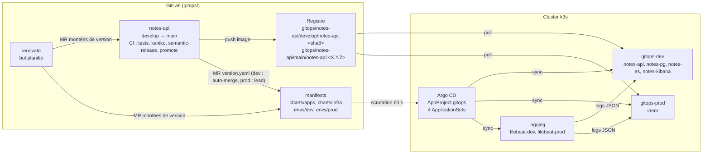
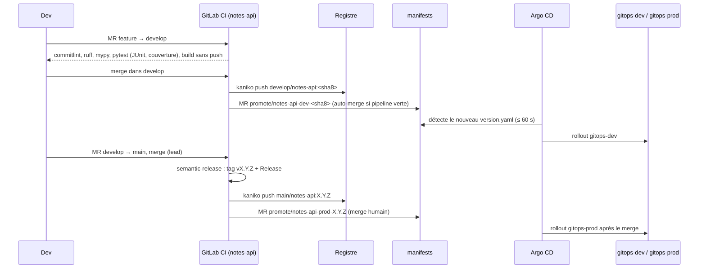

# 01 — Architecture et flux

Principe : **la CI construit et prouve, Argo CD déploie.** La CI de l'application ne possède aucun
identifiant Kubernetes ; son dernier geste est une **merge request** sur le dépôt de manifests. Argo
CD lit ce dépôt et fait converger le cluster.

## Deux dépôts, deux rythmes

| Dépôt | Contenu | Qui écrit | Rythme |
|---|---|---|---|
| `gitops/notes-api` | code Python, tests, Dockerfile, `.gitlab-ci.yml`, `ci/promote.py` | développeurs (MR), semantic-release (tags), Renovate (MR) | à chaque fonctionnalité |
| `gitops/manifests` | charts Helm (apps + infra), `envs/<env>/{values,version}.yaml`, définitions Argo CD | la CI de l'app (MR `version.yaml`), Renovate (MR images infra), équipe plateforme (MR) | apps : à chaque livraison ; infra : rarement |

Le dépôt de manifests sépare ce qui **bouge souvent** (`charts/apps/`) de ce qui **bouge peu**
(`charts/infra/` : PostgreSQL, Elasticsearch/Kibana, Filebeat). Chaque chart a un dossier `envs/`
avec, par environnement, un `values.yaml` (comment déployer ici) et un `version.yaml` (quoi déployer :
l'image). Détail : [CONTRACT.md](../CONTRACT.md) §4.

## Le chemin d'un commit

## Pourquoi ces choix

| Choix | Alternative écartée | Raison |
|---|---|---|
| Tag d'image = sha court en dev, version sémantique en prod | `latest`, numéro de pipeline | traçabilité : un tag → un commit ; prod lisible par un humain ; jamais de tag mobile |
| semantic-release sur `main` | version dans `pyproject.toml` maintenue à la main | la version découle des Conventional Commits, impossible d'oublier de bumper ; le changelog est généré |
| MR sur le dépôt de manifests (dev auto-mergée, prod relue) | push direct du bot ; déploiement par la CI avec `kubectl` | tout changement d'état désiré est un commit révisable et réversible (`git revert`) ; la CI n'a aucun accès au cluster |
| Argo CD ApplicationSets (générateur *files* sur `version.yaml`) | une Application écrite à la main par app et par env | ajouter une app ou un env = ajouter un dossier ; les ApplicationSets sont eux-mêmes versionnés (app-of-apps) |
| kaniko | Docker-in-Docker | pas de conteneur privilégié dans le cluster |
| Image distroless + Python géré par uv | `python:3.13-slim` | pas de shell ni de gestionnaire de paquets dans l'image finale, surface d'attaque minimale, image plus petite |
| Logs : stdout JSON + Filebeat (DaemonSet ECK) + Elasticsearch/Kibana par env | client Elasticsearch dans l'app, sidecar | zéro dépendance et zéro coût dans l'application ; collecte au niveau du nœud, standard Kubernetes ; ECK gère TLS et identifiants |
| Renovate auto-hébergé, une job planifiée | Dependabot (indisponible sur GitLab), MR à la main | couvre Python (`uv.lock`), Dockerfile, images CI, images infra (`version.yaml`), npm |

## Pile de logs : pourquoi cette version est « pro, scalable et légère »

1. **L'application** ne fait que `print` du JSON structuré (structlog) sur stdout : aucun buffer
   réseau, aucune bibliothèque Elastic, aucun secret. Si Elasticsearch tombe, l'application ne le
   sait même pas.
2. **Le nœud** collecte : un DaemonSet Filebeat lit `/var/log/containers`, décode le JSON, ajoute les
   métadonnées Kubernetes (namespace, pod, labels) et envoie en bulk à Elasticsearch, avec file
   d'attente et reprise. Un collecteur par environnement, limité par `autodiscover` au namespace de
   l'environnement : les logs de dev ne finissent jamais dans l'index de prod.
3. **ECK** gère les associations : Filebeat → Elasticsearch, Kibana → Elasticsearch (utilisateurs,
   certificats, CA) sans qu'aucun identifiant ne soit écrit dans git.
4. **Kibana** : data view et dashboard importés automatiquement (Job hook Argo CD) ; un développeur
   filtre par `kubernetes.pod.name`, `log.level`, `request_id`.

Pour aller plus loin en production : un cluster de logs mutualisé (un index/data stream par
environnement, ILM pour la rétention), Elastic Agent + Fleet, ou Fluent Bit si l'on ne veut pas de
pile Elastic côté collecte.
