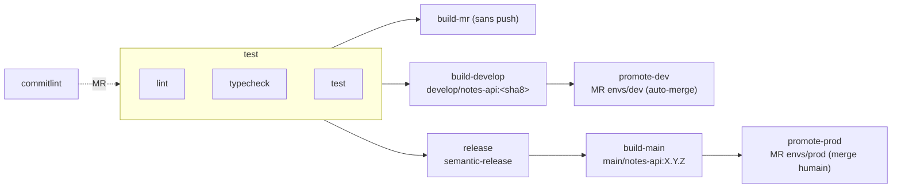

# 05 — Pipeline CI de `notes-api`

Fichier : `repos/notes-api/.gitlab-ci.yml` (commenté). Principe : **la CI construit et prouve, elle ne
déploie pas** ; son dernier geste est une merge request sur `gitops/manifests`. Aucun identifiant
Kubernetes n'existe dans GitLab.

## Quelle pipeline pour quel évènement

| Job | MR (`feature → develop`, `develop → main`) | push/merge `develop` | push/merge `main` |
|---|:-:|:-:|:-:|
| `commitlint` | ✔ | | |
| `lint`, `typecheck`, `test` | ✔ | ✔ | ✔ |
| `build-mr` (`--no-push`) | ✔ | | |
| `build-develop` | | ✔ | |
| `release` (semantic-release) | | | ✔ |
| `build-main` | | | ✔ (si une version a été publiée) |
| `promote-dev` | | ✔ | |
| `promote-prod` | | | ✔ (si une version a été publiée) |

`workflow:rules` : jamais sur un tag (le tag `vX.Y.Z` posé par semantic-release ne redéclenche rien) ;
pipelines de MR ; pipelines de branche pour `develop` et `main` (push, web, API) ; pas de pipeline de
branche pour une branche de fonctionnalité qui a déjà une MR ; rien pour le reste.
Les jobs de test déclarent `needs: []` et démarrent en parallèle ; `build` attend les trois ; `promote`
attend `build`. `interruptible: true` par défaut (un nouveau push annule la pipeline obsolète), sauf
`release`, `build-main` et `promote-*` ; `resource_group` sur `release` et chaque promotion.

## Les jobs

| Job | Image | Ce qu'il fait | Résultat visible dans GitLab |
|---|---|---|---|
| `commitlint` | `node:24.14.0-alpine` | `commitlint --from $CI_MERGE_REQUEST_DIFF_BASE_SHA --to HEAD` : chaque commit de la MR respecte Conventional Commits | job rouge + message explicite |
| `lint` | `ghcr.io/astral-sh/uv:0.10.8-python3.13-trixie-slim` | `uv sync --frozen` ; `ruff check` (rapport Code Quality format gitlab) ; `ruff format --check` | widget **Code Quality** de la MR |
| `typecheck` | idem | `mypy` strict (src + tests) | — |
| `test` | idem + **service** `postgres:17-alpine` | attente de PostgreSQL ; `pytest --junitxml --cov --cov-fail-under=85` (unitaires **et** intégration) ; auto-test de `ci/promote.py` | onglet **Tests** de la pipeline, widget **tests** et **couverture par ligne** de la MR, badge `coverage:` |
| `release` | node | `semantic-release` : analyse des commits depuis le dernier tag, tag `vX.Y.Z`, Release GitLab avec notes ; écrit `release.env` (`RELEASED`, `VERSION`, `RELEASE_TAG`) | **Deploy → Releases**, tag, artefact dotenv |
| `build-*` | `gcr.io/kaniko-project/executor:v1.23.2-debug` | build **sans démon Docker ni privilège**, cache de couches dans `$CI_REGISTRY_IMAGE/cache`, `--build-arg APP_VERSION/APP_COMMIT`, labels OCI ; MR : `--no-push` | **Deploy → Container Registry** : `develop/notes-api`, `main/notes-api` |
| `promote-*` | `python:3.13-alpine3.22` | `ci/promote.py` (stdlib, API GitLab) : met à jour `version.yaml`, ouvre la MR, auto-merge en dev | MR dans `gitops/manifests`, lien dans le log du job |

Toutes les images sont épinglées ; Renovate (manager `gitlabci`) propose leurs montées de version.

## Points d'attention vérifiés

- **Service PostgreSQL avec l'executor Kubernetes** : le service tourne dans le pod du job et répond
  sur `127.0.0.1:5432` ; `ci/wait_for_postgres.py` attend qu'il accepte les connexions (il démarre en
  même temps que le job).
- **`release.env` toujours présent** : le job écrit `RELEASED=false` avant semantic-release ; un
  rapport `dotenv` absent ferait échouer les jobs suivants. Les variables dotenv **ne sont pas
  visibles dans `rules:`** (évaluées à la création de la pipeline) : `build-main` et `promote-prod`
  testent `$VERSION` dans leur script et sortent en succès « no release » si rien n'a été publié
  (commits `chore:`/`docs:` seulement).
- **Tokens** : `GITLAB_TOKEN` (semantic-release) et `MANIFESTS_TOKEN` (promotion) sont des *project
  access tokens* posés en variables **masquées et protégées** : seules les pipelines de `develop` et
  `main` (branches protégées) les voient ; une MR depuis une branche de fonctionnalité ne peut pas les
  exfiltrer. Le job token (`CI_REGISTRY_PASSWORD`) suffit pour pousser dans le registre du projet.
- **Cache** : `.uv-cache` et `.npm` dans le cache GitLab (clé = hash du lock), stockés dans RustFS.

## semantic-release

`.releaserc.json` : branche `main`, `tagFormat v${version}`, plugins `commit-analyzer`
(preset `conventionalcommits`), `release-notes-generator`, `gitlab` (Release GitLab), `exec`
(`successCmd` → `release.env`). Pas de plugin `git` : rien n'est recommité sur `main` (branche
protégée), la version vit dans les tags et les Releases. `GIT_DEPTH: 0` + `GIT_STRATEGY: clone` pour
que l'historique complet soit disponible.

## Promotion (`ci/promote.py`)

Idempotent et sans clone : lit `version.yaml` sur `main` (rien à faire si déjà à jour), crée la branche
`promote/notes-api-<env>-<tag>`, commite le fichier complet (image, tag, `source.commit/ref/pipeline`),
ouvre ou met à jour la MR (labels `promotion`, `env::<env>`, suppression de la branche source), ferme
les MR de promotion plus anciennes du même environnement, puis en **dev** demande le merge automatique
quand la pipeline de la MR réussit (merge immédiat si elle a déjà réussi, retries sur 405/406/409/422
tant que la MR n'est pas « mergeable »). En **prod**, pas de merge : le lead relit et merge.
Le token ne quitte jamais l'en-tête `PRIVATE-TOKEN`. `--dry-run` affiche le plan et le fichier rendu.
