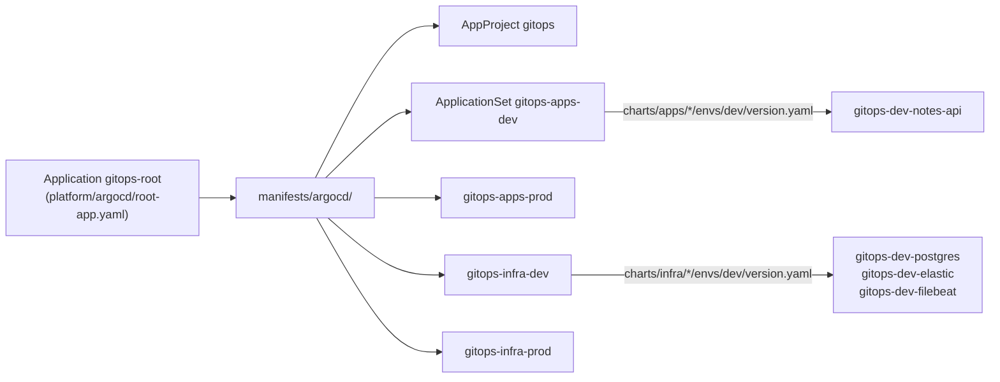

# 06 — Dépôt de manifests et Argo CD

Sources : `repos/manifests/` (projet GitLab `gitops/manifests`, une seule branche `main`, tout passe
par MR). Argo CD est **la seule chose qui écrit** dans `gitops-dev`, `gitops-prod` et `logging`.

## Le dépôt

```
manifests/
├── argocd/                       # état désiré d'Argo CD lui-même (AppProject + 4 ApplicationSets)
└── charts/
    ├── apps/notes-api/           # bouge souvent : à chaque livraison
    │   ├── Chart.yaml values.yaml values.schema.json templates/
    │   └── envs/{dev,prod}/{values.yaml,version.yaml}
    └── infra/                    # bouge peu : montées de version par Renovate
        ├── postgres/   Cluster CloudNativePG notes-pg              (+ envs/)
        ├── elastic/    Elasticsearch notes-es, Kibana notes-kibana, Ingress, import Kibana (+ envs/)
        └── filebeat/   Beat ECK filebeat-<env> dans logging, RBAC                   (+ envs/)
```

| Fichier | Rôle | Qui l'écrit |
|---|---|---|
| `envs/<env>/values.yaml` | **comment** déployer dans cet env : hôte, réplicas, ressources, niveau de log, PDB | humains (MR) |
| `envs/<env>/version.yaml` | **quoi** déployer : `image.repository`, `image.tag` (+ `source.*` pour la traçabilité) | apps : la CI de `notes-api` ; infra : Renovate |

`values.schema.json` de chaque chart **exige** `image.repository` et `image.tag` non vides : un rendu
sans les paramètres d'Argo CD échoue volontairement (on ne déploie jamais une image « par défaut »).

## Argo CD : app-of-apps + ApplicationSets



- **Une seule ressource appliquée à la main** : l'Application racine `gitops-root` (bootstrap). Elle
  synchronise `argocd/` ; les ApplicationSets et le projet sont donc eux-mêmes versionnés et modifiables
  par MR.
- **Générateur git *files*** : une Application par `version.yaml` trouvé. Le fichier est injecté dans
  le template (`{{ .image.repository }}`, `{{ .image.tag }}`) et passé au chart en **paramètres Helm**
  (`forceString: true`) ; `envs/<env>/values.yaml` est le fichier de values. `goTemplateOptions:
  missingkey=error` : un `version.yaml` incomplet met l'ApplicationSet en erreur au lieu de générer une
  Application cassée (d'où le job `validate-versions` de la CI du dépôt).
- Nom : `gitops-<env>-<chart>` avec `{{ index .path.segments 2 }}` (avec ce générateur,
  `.path.basename` vaut `dev`, pas le nom du chart). `releaseName: <chart>` : les ressources s'appellent
  `notes-api`, `notes-pg`… dans tous les environnements.
- **Dev et prod lisent des chemins différents** (`envs/dev/`, `envs/prod/`) et visent des namespaces
  différents : la destination est dérivée du chemin, un fichier posé dans `envs/dev/` ne peut pas
  déployer en prod.
- Labels `gitops.lab/env`, `gitops.lab/kind` (`app`/`infra`), `gitops.lab/component` pour filtrer l'UI.

### AppProject `gitops`

Dépôt source : `gitops/manifests` uniquement. Destinations : `gitops-dev`, `gitops-prod`, `logging`.
Ressources cluster autorisées : `Namespace`, `ClusterRole`, `ClusterRoleBinding` (RBAC de Filebeat).
`orphanedResources.warn` : une ressource présente dans un namespace mais absente de git est signalée.

### Politique de synchronisation (identique dev / prod)

| Option | Effet |
|---|---|
| `automated {prune, selfHeal}` | un commit mergé est appliqué sans clic ; une ressource retirée de git est supprimée ; un `kubectl edit` est annulé |
| `CreateNamespace` + `managedNamespaceMetadata` | le namespace reçoit ses labels Pod Security (`enforce: baseline`, `warn/audit: restricted`) |
| `ServerSideApply` | CRD volumineuses (ECK, CNPG) et champs gérés par les opérateurs fusionnés proprement |
| `RespectIgnoreDifferences`, `ignoreDifferences` | apps : `/spec/replicas` (HPA) ; infra : `volumeClaimTemplates` des StatefulSets (champ immuable décoré par l'API server) |
| `retry` exponentiel (10 s → 5 min, 10 essais) | une app dont la dépendance n'est pas prête (CRD, Secret) réessaie au lieu d'échouer |
| apps : finalizer / infra : `preserveResourcesOnDeletion` + `Prune=false` sur `Cluster` et `Elasticsearch` | supprimer un dossier d'app supprime ses ressources ; supprimer un dossier d'infra **ne supprime jamais une base** |
| `sync-wave` `-1` (infra) / `1` (apps) | ordre indicatif ; entre ApplicationSets distincts les syncs sont parallèles, c'est la readiness de `notes-api` (`/readyz`) et le `retry` qui assurent la convergence |

**Prod aussi en automatique**, à dessein : la barrière est la **MR relue et mergée par un lead** dans
`gitops/manifests`. Une fois mergée, rien ne justifie un second clic ailleurs, et `selfHeal` garantit
que prod reste égale à git.

## Le chart `notes-api`

Deployment (RollingUpdate `maxUnavailable: 0`, probes `/healthz` et `/readyz`, `readOnlyRootFilesystem`,
non-root 65532, `drop: [ALL]`, seccomp `RuntimeDefault`, `emptyDir` sur `/tmp`), Service, Ingress
Traefik (`notes.<env>.127-0-0-1.sslip.io`), ServiceAccount sans token, HPA/PDB/NetworkPolicy optionnels
(PDB et `topologySpread` activés en prod). Env : `DATABASE_URL` depuis le Secret CNPG `notes-pg-app`
(clé `uri`), `APP_ENV`, `APP_VERSION={{ image.tag }}`, `LOG_LEVEL`. `imagePullSecrets:
registry-credentials` (Secret créé par le bootstrap à partir d'un deploy token `read_registry`).

## Les charts infra

| Chart | Ressources | `version.yaml` |
|---|---|---|
| `postgres` | `Cluster` CNPG `notes-pg` (1 instance, 2 Gi, base `notes`, Secret `notes-pg-app` généré) | `ghcr.io/cloudnative-pg/postgresql:17.11` |
| `elastic` | `Elasticsearch notes-es` (1 nœud, heap 512 Mo, `allow_mmap: false`, TLS interne), `Kibana notes-kibana` (HTTP, Ingress `kibana.<env>…`), Job **PostSync** d'import des objets Kibana (data view `filebeat-*`, recherche, graphique, dashboard) | `docker.elastic.co/elasticsearch/elasticsearch:8.19.6` (Kibana suit la même version) |
| `filebeat` | `Beat filebeat-<env>` (DaemonSet dans `logging`, autodiscover limité à `gitops-<env>`, `decode_json_fields`), ServiceAccount + ClusterRole + ClusterRoleBinding, `elasticsearchRef` inter-namespaces | `docker.elastic.co/beats/filebeat:8.19.6` |

## CI du dépôt de manifests

Une MR (humaine, de la CI de `notes-api` ou de Renovate) n'est mergeable que si cette pipeline est
verte : `yamllint`, `validate-versions` (contrat des `version.yaml`, parse des manifests `argocd/`),
`helm-lint` (`helm lint --strict` + `helm template` par chart et par env, rendus en artefact),
`kubeconform` (schémas Kubernetes, CRD ignorées). C'est ce qui rend l'**auto-merge des promotions dev**
raisonnable.

## Revenir en arrière

```bash
git revert <commit de promotion>    # ou « Revert » dans l'UI GitLab : une MR
```

Argo CD redéploie l'image précédente, toujours présente dans le registre. L'historique du dépôt de
manifests **est** le journal des déploiements : qui, quand, quoi, approuvé par qui.
