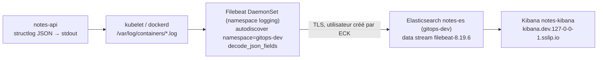

# 07 — Logs : structlog → Filebeat → Elasticsearch → Kibana

## Le choix

| Option | Coût pour l'application | Scalabilité | Verdict |
|---|---|---|---|
| Client Elasticsearch **dans** l'application (handler Python) | fort : dépendance, buffer, retries, secrets ES dans chaque pod ; une panne ES bloque ou perd des logs | mauvaise (N apps × N connexions) | écarté |
| Sidecar Filebeat par pod | moyen : un conteneur de plus par réplica, à déclarer dans chaque chart | moyenne | écarté |
| **stdout JSON + DaemonSet Filebeat (ECK)** | **nul** : l'app fait `print` | bonne : un agent par nœud, bulk, file d'attente, reprise sur panne ; ECK gère TLS et identifiants | **retenu** |
| Fluent Bit (DaemonSet) | nul | très bonne, plus léger | alternative valable ; sans ECK il faut gérer les identifiants ES soi-même |

C'est le modèle standard Kubernetes : **l'application écrit sur stdout, la plateforme collecte.**



Un Filebeat **par environnement** (`filebeat-dev`, `filebeat-prod`), chacun limité par `autodiscover`
au namespace de son environnement et branché sur l'Elasticsearch de cet environnement
(`elasticsearchRef` inter-namespaces). Vérifié : l'index de dev ne contient que des documents
`kubernetes.namespace: gitops-dev` (agrégation `terms`), ~1 000 documents dès le démarrage
(Elasticsearch, Kibana, PostgreSQL, puis l'application).

## Configuration (chart `charts/infra/filebeat`, `charts/infra/elastic`)

| Élément | Valeur | Pourquoi |
|---|---|---|
| `Beat` ECK `filebeat-<env>` dans **`logging`** | `type: filebeat`, DaemonSet, `runAsUser: 0`, hostPath `/var/log/containers`, `/var/log/pods`, `/var/lib/docker/containers` (lecture seule) | lecture des fichiers de logs du nœud ; `logging` est le seul namespace applicatif en PSA `privileged` |
| `elasticsearchRef: {name: notes-es, namespace: gitops-<env>}` | association gérée par ECK | ECK crée l'utilisateur, le Secret et la CA dans `logging` : aucun identifiant dans git |
| `filebeat.autodiscover.providers[kubernetes]` | `node: ${NODE_NAME}`, `namespace: gitops-<env>`, template `condition.equals.kubernetes.namespace` | ne surveille **que** les pods de l'environnement ; les métadonnées Kubernetes (pod, labels, conteneur) sont ajoutées à chaque ligne |
| input `container` + `decode_json_fields` (`target: ""`, `overwrite_keys`, `expand_keys`, `max_depth: 2`) | les champs structlog (`log.level`, `message`, `request_id`, `http.*`…) remontent à la racine du document | requêtes et visualisations Kibana sur les vrais champs, pas sur une chaîne |
| `setup.template.settings.index.number_of_replicas: 0` | un seul nœud Elasticsearch | sinon l'index reste `yellow`, Argo CD voit l'application `Progressing` et le hook Kibana n'est jamais lancé |
| RBAC : ServiceAccount + ClusterRole (`pods`, `namespaces`, `nodes`, `replicasets`, `jobs` : get/list/watch) | autodiscover | lecture seule |
| `Elasticsearch notes-es` | 1 nœud, heap 512 Mo, `node.store.allow_mmap: false`, 2 Gi, TLS interne conservé | pas d'init container privilégié (`vm.max_map_count`) ; TLS entre composants géré par ECK |
| `Kibana notes-kibana` | HTTP (TLS auto-signé désactivé), Ingress Traefik `kibana.<env>.127-0-0-1.sslip.io`, `server.publicBaseUrl` | derrière Traefik en HTTP (lab) |
| Job **PostSync** Argo CD | `curl` → `POST /api/saved_objects/_import?overwrite=true` (data view `filebeat-*`, recherche « Logs notes-api », graphique par niveau, dashboard) | zéro clic : à chaque sync, Kibana a sa data view et son dashboard (vérifié : `successCount: 4`) |

Versions : une seule valeur `image.tag` (`8.19.6`) par environnement pour Elasticsearch et Kibana
(`charts/infra/elastic/envs/<env>/version.yaml`), une pour Filebeat ; Renovate les regroupe (« elastic
stack ») pour qu'elles bougent ensemble.

## Lire les logs dans Kibana

1. `http://kibana.dev.127-0-0-1.sslip.io` → `elastic` / mot de passe :
   `kubectl -n gitops-dev get secret notes-es-es-elastic-user -o jsonpath='{.data.elastic}' | base64 -d`
2. **Discover**, data view « Logs (filebeat-*) », recherche enregistrée « Logs notes-api » : colonnes
   `log.level`, `message`, `kubernetes.pod.name`, `request_id`, `http.status_code`.
3. Filtres utiles (KQL) :
   - `service.name : "notes-api" and http.status_code >= 500`
   - `request_id : "…"` (toutes les lignes d'une requête, y compris celles du code métier)
   - `kubernetes.pod.name : notes-pg-1` (logs PostgreSQL du même environnement)
   - `log.level : "error"`
4. **Dashboard** « notes-api — logs » : volume par niveau dans le temps + la recherche.

## Vérifier sans Kibana

```bash
PW=$(kubectl -n gitops-dev get secret notes-es-es-elastic-user -o jsonpath='{.data.elastic}' | base64 -d)
kubectl -n gitops-dev exec notes-es-es-default-0 -- curl -sk -u elastic:$PW \
  'https://localhost:9200/_cat/indices/.ds-filebeat*?v'
kubectl -n gitops-dev exec notes-es-es-default-0 -- curl -sk -u elastic:$PW -H 'Content-Type: application/json' \
  'https://localhost:9200/filebeat-*/_search?size=1&q=service.name:notes-api' | jq '.hits.hits[0]._source | {message, "log.level", request_id, "http.status_code", kubernetes: .kubernetes.pod.name}'
kubectl -n logging logs ds/filebeat-dev-beat-filebeat --tail=20
```

## En production

Cluster de logs mutualisé (un data stream par environnement/équipe, ILM pour la rétention et le
passage en *warm/cold*), 3 nœuds Elasticsearch, Kibana derrière SSO, utilisateurs/rôles dédiés plutôt
que `elastic`, alertes Kibana sur `log.level: error`, et Elastic Agent + Fleet (ou Fluent Bit) comme
collecteur unique par nœud avec routage par namespace.
